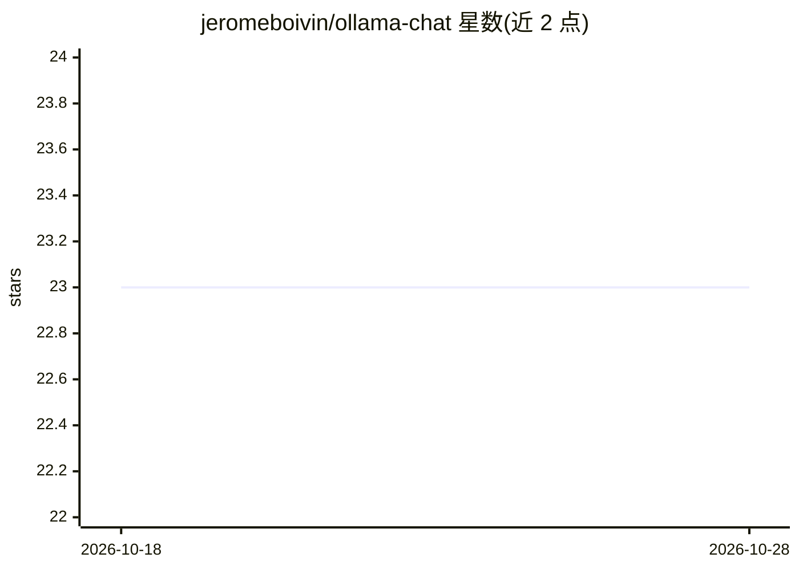

# jeromeboivin/ollama-chat

⭐ 23 · Python · 推送 2026-08-31 · [GitHub](https://github.com/jeromeboivin/ollama-chat) · 个人维护

**面向本地 LLM 的可扩展 Python CLI 聊天工具，带 RAG 与插件系统**

Python 命令行聊天工具：通过本地运行的 Ollama 或 Llama-Cpp 服务器与 OpenAI API 对话，数据不离开本机。集成 ChromaDB 向量数据库提供 RAG 能力，支持文档索引/查询、可配置分块、选择性提取、AI 摘要与全文存储；内置网页搜索命令（/web）将文章分块入库；支持跨会话记忆与自定义插件扩展。提供大量命令行参数（模型、温度、系统提示、对话保存等）。安装方式为 git clone 源码加 pip 依赖，需自行启动 Ollama 或 Llama-Cpp 服务器。

## 筛选速览

| 维度 | 判定 | 备注 |
|---|---|---|
| AI 角色 | `ai-ecosystem` | LLM/agent 周边工具 |
| 许可风险 | `none` | — |
| 部署形态 | `library` | 以包/库形式分发 |
| 模型依赖 | local-ok | 支持本地模型 |
| 硬件要求 | — | 无带数字的原话,不猜 |
| 安装摩擦 | `low` | 无编译、无系统依赖或容器化 |
| 成熟度 | — | 结构信号不足 |

## 能力要点

- 本地运行 LLM（Ollama/Llama-Cpp）并兼容 OpenAI API
- 基于 ChromaDB 的 RAG：文档索引、分块、提取、AI 摘要、全文存储
- 插件系统扩展命令与行为，支持自定义聊天人格（系统提示）
- 网页搜索结果分块存入向量库供回答引用

## 适用场景

- 在终端与本地模型对话且数据不出本机
- 对自己的文档做命令行索引与检索问答
- 通过插件定制聊天命令与工作流

## 场景标签

`聊天机器人` `RAG` · 领域:对话与助手

## 证据(README 行号)

> L3: **Ollama-Chat** is a powerful, customizable Python CLI tool that interacts with local Language Models (LLMs) via `Ol
> L137: This guide will explain how to use the `ollama_chat.py` script. This script is designed to act as a terminal-based
> L149: 5. **Use Ollama or OpenAI API (Llama-CPP)**: By default, the script uses Ollama. If you want to use the OpenAI API

## 星数曲线

2026-10-18 23 → 2026-10-28 23（+0）

---
*卡片 v1 · prompt 1.4 · 生成 2026-10-27 · 置信度 mid · 依据 README sha `9b4c11e67be9` · [字段定义](../../DATASET.md)*
