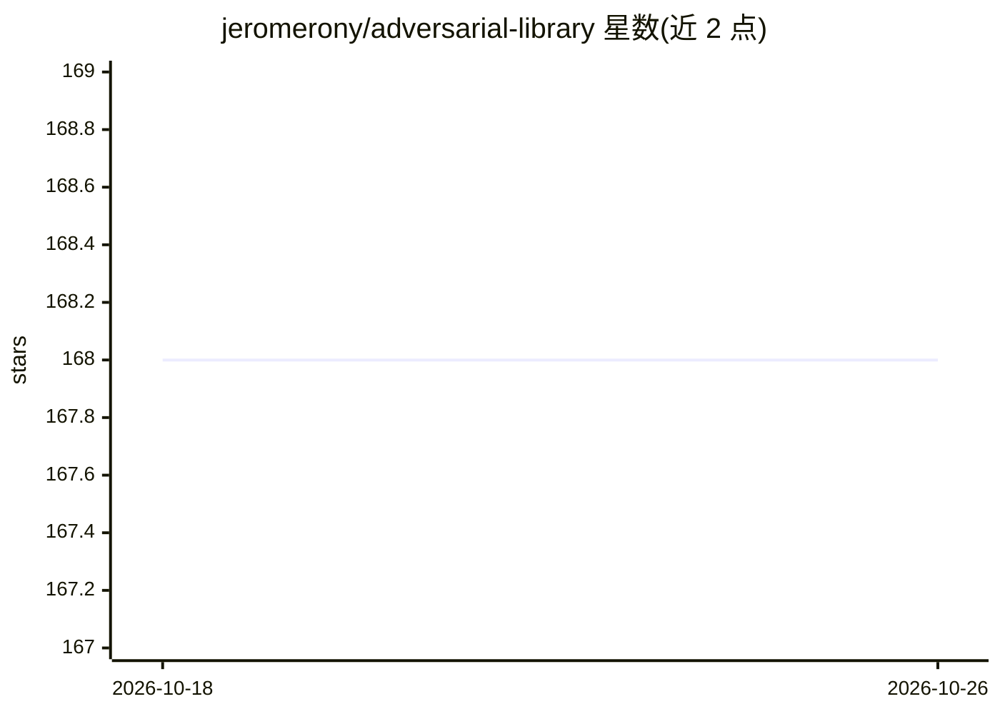

# jeromerony/adversarial-library

⭐ 168 · Python · BSD-3-Clause · 推送 2026-06-20 · [GitHub](https://github.com/jeromerony/adversarial-library) · 个人维护

**面向科研人员的 PyTorch 对抗攻击实现库**

以 PyTorch 实现多种对抗攻击的 Python 库，面向寻找 state-of-the-art 攻击实现的研究者。攻击以纯函数形式调用：给定模型、样本与标签即返回对抗样本；另提供 SSIM/CIEDE2000/LPIPS 距离、投影、损失、visdom 回调等工具，run_attack 辅助函数以固定 batch size 执行攻击并报告运行时间与前向/反向传播次数等复杂度指标。依赖 pytorch>=2.0.0、torchvision、tqdm、visdom，依赖随新版 PyTorch 定期更新，可能产生破坏性变更。

## 筛选速览

| 维度 | 判定 | 备注 |
|---|---|---|
| AI 角色 | `ai-native` | 本体是模型或模型工具 |
| 许可风险 | `permissive` | BSD-3-Clause |
| 部署形态 | `library` | 以包/库形式分发 |
| 模型依赖 | — | README 未给出锁定关系 |
| 硬件要求 | — | 无带数字的原话,不猜 |
| 安装摩擦 | `low` | 无编译、无系统依赖或容器化 |
| 成熟度 | — | 结构信号不足 |

## 能力要点

- 攻击以纯函数实现，直接传入 model/inputs/labels 调用
- 提供 SSIM、CIEDE2000、LPIPS 距离与投影、损失等工具
- run_attack 报告运行时间与前向/反向传播次数等复杂度指标
- 依赖跟踪新版 PyTorch，预期定期更新

## 适用场景

- 复现和对比各类对抗攻击方法的科研实验
- 评估分类模型对对抗样本的鲁棒性
- 在自有训练流程中生成对抗样本

## 场景标签

`科研工具` · 领域:学习与行业

## 证据(README 行号)

> L5: This library contains various resources related to adversarial attacks implemented in PyTorch. It is aimed towards r
> L9: While focused on attacks, this library also provides several utilities related to adversarial attacks: distances (SS

## 星数曲线

2026-10-18 168 → 2026-10-26 168（+0）

---
*卡片 v1 · prompt 1.4 · 生成 2026-10-22 · 置信度 high · 依据 README sha `504d92e2d0ef` · [字段定义](../../DATASET.md)*
