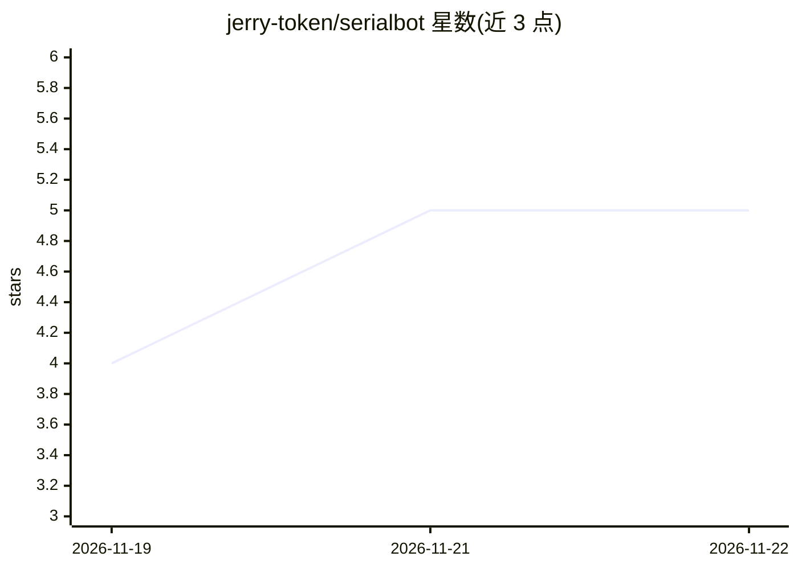

# jerry-token/serialbot

⭐ 5 · Rust · GPL-3.0 · 推送 2026-11-20 · [GitHub](https://github.com/jerry-token/serialbot) · 个人维护 · 中文 README

**嵌入式开发者的串口调试助手，内置 MCP 让 AI agent 操作串口**

跨平台（Windows/macOS/Linux，含 x64 与 arm64）桌面串口调试工具，提供多端口标签会话、TCP/UDP 连接、HEX/文本收发、ANSI 彩色日志、时间戳与帧间隔、实时曲线绘制、终端模式（可登录板子 shell）、CRC 校验附加与定时发送。AI 部分：内置 MCP 服务器（HTTP 与 stdio），暴露约 20 个工具供 Claude Code、Claude Desktop 等 agent 列举/打开端口、收发数据、等待匹配回复、切换 DTR/RTS、把端口暂时交给烧录工具；每次操作需用户批准并在日志中标记 AI。分发为安装包/便携可执行文件，标注 Beta。

## 筛选速览

| 维度 | 判定 | 备注 |
|---|---|---|
| AI 角色 | `ai-enhanced` | 去掉 AI 部分产品仍成立 |
| 许可风险 | `viral` | GPL-3.0 |
| 部署形态 | `desktop` | 安装包/桌面程序 |
| 模型依赖 | — | README 未给出锁定关系 |
| 硬件要求 | — | 无带数字的原话,不猜 |
| 安装摩擦 | `low` | 无编译、无系统依赖或容器化 |
| 成熟度 | `idea` | |

## 能力要点

- 内置 MCP 服务器（HTTP/stdio），提供 port.list、io.write、io.wait_for 等 20 个工具
- agent 每次操作需用户批准（allow once/session/deny），日志标记 AI 行
- 支持热插拔续接会话、多端口并行、TCP 客户端/服务器/UDP
- 实时曲线绘制与 VT100 终端模式（可操作板上 shell）

## 适用场景

- 让 Claude Code 自己烧录固件、读串口日志并验证代码是否工作
- 调试 ESP32/STM32 开发板的多路串口与网络连接
- 通过曲线实时查看传感器数据输出
- 用终端模式登录运行 Linux 的板子 shell

## 场景标签

 · 领域:嵌入式开发工具/串口调试

## 证据(README 行号)

> L5: **The verification loop for embedded hardware: a lightweight serial assistant whose built-in MCP server lets AI agen
> L37: **SerialBot only moves the data; your skills bring the knowledge.** SerialBot passes raw bytes between the device a
> L67: - 🤖 A built-in MCP server lets Claude Code, Claude Desktop and other agents list and open ports, send data, wait fo

## 星数曲线

2026-11-19 4 → 2026-11-22 5（+1）

---
*卡片 v1 · prompt 1.4 · 生成 2026-11-21 · 置信度 high · 依据 README sha `66a747c5de6e` · [字段定义](../../DATASET.md)*
