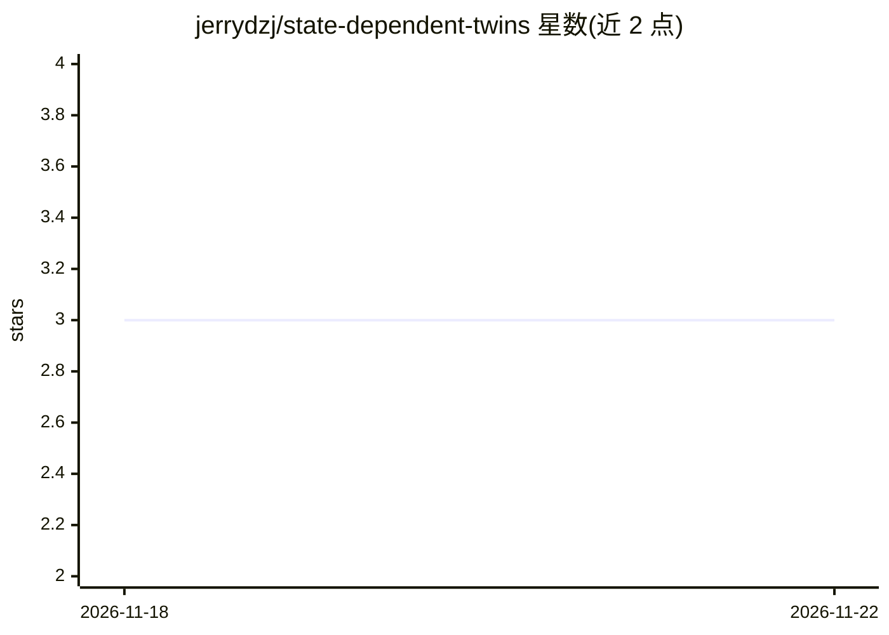

# jerrydzj/state-dependent-twins

⭐ 3 · Jupyter Notebook · MIT · 推送 2026-11-21 · [GitHub](https://github.com/jerrydzj/state-dependent-twins) · [官网](https://osf.io/ahgkw) · 个人维护

**检验 LLM 数字孪生能否预测随外部状态变化调查答案的研究项目**

一项在 OSF 预注册的研究，用 Llama 3.1 8B Instruct 作为'数字孪生'回答密歇根消费者调查的五道问题，并与 logit、ridge logit、梯度提升等监督模型在相同输入下比较预测精度。核心机制是校准孪生（shifted/scaled）将模型概率调整到训练窗口的网络访谈水平，评估窗口为 2024 年 8 月至 2026 年 2 月。仓库以 notebooks、src/sdt 代码包与实验记录组织，附完整的复现步骤；代码 MIT 许可，调查微数据不含在内。

## 筛选速览

| 维度 | 判定 | 备注 |
|---|---|---|
| AI 角色 | `ai-native` | 本体是模型或模型工具 |
| 许可风险 | `permissive` | MIT |
| 部署形态 | `library` | 以包/库形式分发 |
| 模型依赖 | — | README 未给出锁定关系 |
| 硬件要求 | — | 无带数字的原话,不猜 |
| 安装摩擦 | `low` | 无编译、无系统依赖或容器化 |
| 成熟度 | `idea` | |

## 能力要点

- 以 Llama 3.1 8B Instruct 构建调查受访者数字孪生
- 两个校准孪生（shifted/scaled）将概率调整到训练窗口
- OSF 预注册并用'与训练域的距离'作为预注册检验指标
- notebooks/ 按时间顺序记录，实验结果不可变存档

## 适用场景

- 复现或扩展 LLM 数字孪生对消费者调查的预测研究
- 研究分布漂移下 LLM 与监督模型的预测表现比较
- 学习预注册社会科学研究的工程组织方式

## 场景标签

`科研工具` `模型评测` `教程课程` · 领域:评测与运维

## 证据(README 行号)

> L5: A twin is a language model given a respondent's attributes and asked how that respondent answers. **This project ask
> L15: about their finances and the economy. Twins and supervised models predict each respondent's answers to the five
> L19: fitted to the training window, February 2017 to July 2024. The twin is Llama 3.1 8B Instruct, and two calibrated tw

## 星数曲线

2026-11-18 3 → 2026-11-22 3（+0）

---
*卡片 v1 · prompt 1.4 · 生成 2026-11-21 · 置信度 high · 依据 README sha `b47719fa4240` · [字段定义](../../DATASET.md)*
