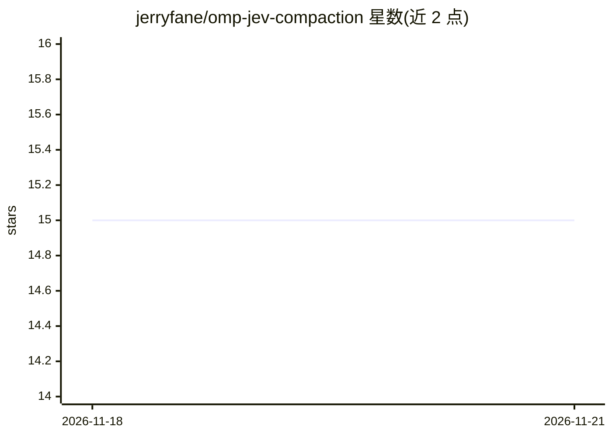

# jerryfane/omp-jev-compaction

⭐ 15 · TypeScript · MIT · 推送 2026-11-17 · [GitHub](https://github.com/jerryfane/omp-jev-compaction) · 个人维护

**omp 编码代理的上下文压缩插件：请求前丢弃陈旧工具输出**

面向 omp（oh-my-pi）编码代理的插件：在每次模型请求前调用 Jev（TypeSafe 的决策模型，可经 TypeSafe 或 OpenRouter 访问）评估哪些旧工具结果仍被需要，低分者被裁剪为短头部并保存原文至本地文件供代理回读；用户与助手消息不被改动，不做摘要，无 key 或出错时 fail-open 继续运行。实测数据：上下文字符量降 16%，每次决策约 $0.0005 与 430ms；150,000 字符以下的上下文不处理。支持 keyless relay 与多项环境变量配置。

## 筛选速览

| 维度 | 判定 | 备注 |
|---|---|---|
| AI 角色 | `ai-ecosystem` | LLM/agent 周边工具 |
| 许可风险 | `permissive` | MIT |
| 部署形态 | `library` | 以包/库形式分发 |
| 模型依赖 | locked-api |  |
| 硬件要求 | — | 无带数字的原话,不猜 |
| 安装摩擦 | `low` | 无编译、无系统依赖或容器化 |
| 成熟度 | — | 结构信号不足 |

## 能力要点

- 每次请求前用 Jev 决策模型判定并丢弃陈旧工具输出
- 被丢弃的原文保存到 ~/.omp/jev-spill/ 供一次性 read 回读，不做摘要
- fail-open：无 key、超时或错误时代理照常运行
- 支持 TypeSafe 与 OpenRouter 两种提供方及 keyless relay

## 适用场景

- 长时间编码会话中控制上下文与请求成本
- 在保留可回读原文的前提下裁剪大量文件读取与日志输出
- 配合 prompt caching 使用而不破坏缓存前缀

## 场景标签

`Agent 记忆` · 领域:Agent 开发

## 证据(README 行号)

> L6: A plugin for omp. Before each model request it asks
> L7: Jev, TypeSafe's small decision model, which old tool results the agent still

## 星数曲线

2026-11-18 15 → 2026-11-21 15（+0）

---
*卡片 v1 · prompt 1.4 · 生成 2026-11-18 · 置信度 mid · 依据 README sha `4c81a64bdc31` · [字段定义](../../DATASET.md)*
