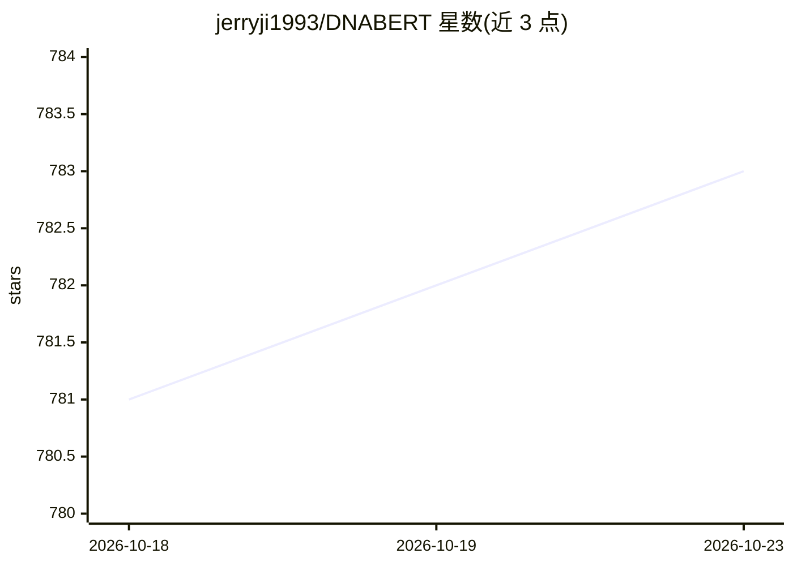

# jerryji1993/DNABERT

⭐ 783 · Python · Apache-2.0 · 推送 2026-01-22 · [GitHub](https://github.com/jerryji1993/DNABERT) · [官网](https://doi.org/10.1093/bioinformatics/btab083) · 组织维护

**基因组 DNA 语言预训练 BERT 模型：预训练、微调与预测**

面向基因组研究的 DNA 语言预训练 Transformer 模型实现，基于 HuggingFace 代码扩展适配 DNA 场景。提供源代码、预训练模型（kmer=3/4/5/6，托管于 HuggingFace）、示例与可视化工具，覆盖预训练、任务微调、预测、注意力可视化、motif 分析与 SNP 等基因组变异效应分析流程。要求 Python 3.6、PyTorch 与至少一块 NVIDIA GPU（CUDA 10.0，驱动≥410.48），序列需转为 kmer 格式。作者已发布第二代 DNABERT-2（另一仓库）。

## 筛选速览

| 维度 | 判定 | 备注 |
|---|---|---|
| AI 角色 | `ai-native` | 本体是模型或模型工具 |
| 许可风险 | `permissive` | Apache-2.0 |
| 部署形态 | `library` | 以包/库形式分发 |
| 模型依赖 | — | README 未给出锁定关系 |
| 硬件要求 | — | 无带数字的原话,不猜 |
| 安装摩擦 | `medium` | 含编译或系统依赖之一 |
| 成熟度 | `idea` | |

## 能力要点

- 提供 kmer=3/4/5/6 预训练模型与微调模型下载
- 支持预训练、微调、预测、注意力可视化、motif 分析完整流程
- 内置 SNP 等基因组变异效应分析脚本（突变热图/差异分数）
- 提供 seq2kmer 序列转换函数与示例数据模板

## 适用场景

- 在自有基因组数据上微调 DNA 语言模型做分类预测
- 分析转录因子结合位点等任务的注意力与 motif
- 计算 SNP 等序列突变对模型预测的影响

## 场景标签

`微调` `模型训练` · 领域:训练与推理

## 证据(README 行号)

> L1: # DNABERT
> L4:  In this package, we provides resources including: source codes of the DNABERT model, usage examples, pre-trained mo

## 星数曲线

2026-10-18 781 → 2026-10-23 783（+2）

---
*卡片 v1 · prompt 1.4 · 生成 2026-10-21 · 置信度 mid · 依据 README sha `aec4cfeb1bb9` · [字段定义](../../DATASET.md)*
