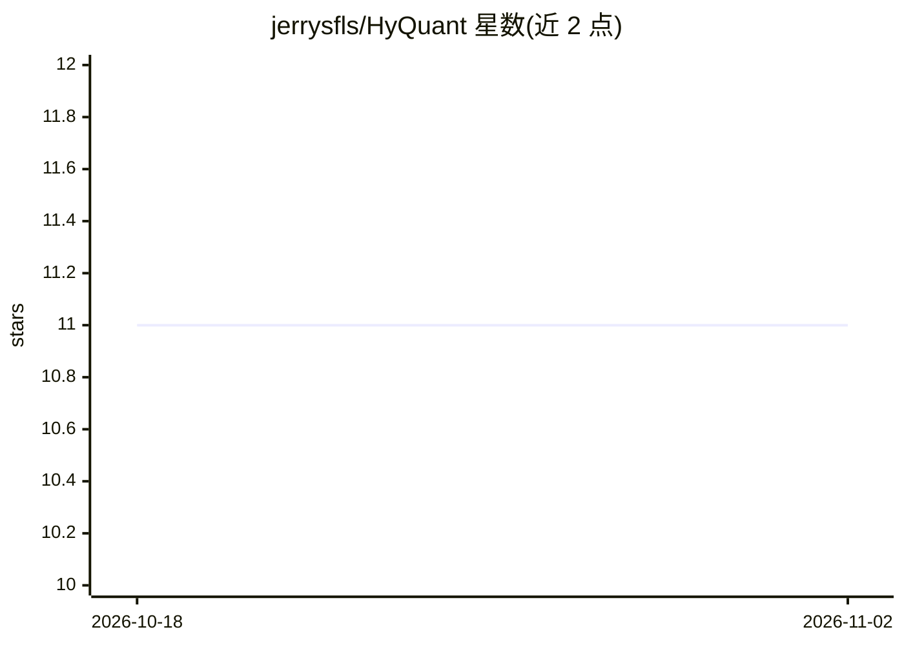

# jerrysfls/HyQuant

⭐ 11 · Python · MIT · 推送 2026-09-16 · [GitHub](https://github.com/jerrysfls/HyQuant) · 个人维护

**面向研究者的高效 LLM 推理研究者：混合精度注意力与 KV cache 量化**

EMNLP 2026 论文 HyQuant 的官方实现：在 LLM 注意力中识别少量 accuracy-critical 的 vertical-line key 位置（默认 top-5%）保留全精度，其余 token 量化到低比特；prefill 用单 Triton 内核融合 INT8 QKᵀ 与 FP16/BF16 段，decode 将 KV cache 重组为四段并把反量化融合进 split-K 解码内核。以 HuggingFace 模型的 in-place attention patch 形式提供（Qwen3/Llama-3/GLM-4 自动检测），附 LongBench 复现脚本。要求 Python 3.10+、CUDA 12.0+、SM80+ GPU，论文实验均在 H100 上完成；MIT 许可。

## 筛选速览

| 维度 | 判定 | 备注 |
|---|---|---|
| AI 角色 | `ai-ecosystem` | LLM/agent 周边工具 |
| 许可风险 | `permissive` | MIT |
| 部署形态 | `library` | 以包/库形式分发 |
| 模型依赖 | — | README 未给出锁定关系 |
| 硬件要求 | — | 无带数字的原话,不猜 |
| 安装摩擦 | `medium` | 含编译或系统依赖之一 |
| 成熟度 | — | 结构信号不足 |

## 能力要点

- vertical-line 识别仅需每层一次 matmul，占运行时 3–5%
- decode 阶段四段式混合精度 KV cache，反量化融合进 split-K 内核
- 以 in-place patch 接入 HuggingFace 模型，Qwen3/Llama-3/GLM-4 自动检测
- 提供完整模式参考与 LongBench 论文复现脚本

## 适用场景

- 在单卡 A100/H100 上加速长上下文 LLM 的解码
- 复现或对比论文中的混合精度量化实验
- 研究 KV cache 量化方法在精度与速度间的权衡

## 场景标签

`模型量化` · 领域:训练与推理

## 证据(README 行号)

> L147: HyQuant is applied as an in-place attention patch; Qwen3, Llama-3, and GLM-4 are
> L152: from src.patch import patch_attention_forward_model

## 星数曲线

2026-10-18 11 → 2026-11-02 11（+0）

---
*卡片 v1 · prompt 1.4 · 生成 2026-11-02 · 置信度 mid · 依据 README sha `3083efbca9fe` · [字段定义](../../DATASET.md)*
