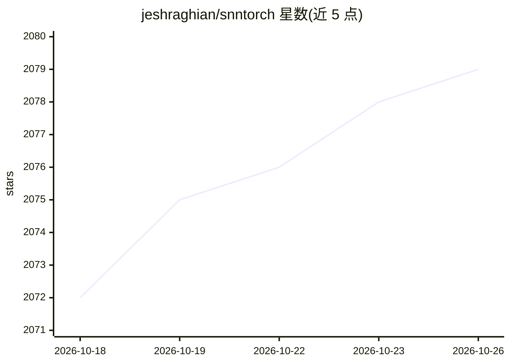

# jeshraghian/snntorch

⭐ 2,079 · Python · MIT · 推送 2026-10-20 · [GitHub](https://github.com/jeshraghian/snntorch) · [官网](https://snntorch.readthedocs.io/en/latest/) · 个人维护

**面向开发者的脉冲神经网络（SNN）PyTorch 训练库**

snnTorch 是一个用于对脉冲神经网络执行梯度学习的 Python 库，基于 PyTorch 扩展，将预置的脉冲神经元模型作为循环激活单元集成到 autograd 中，支持 GPU（CUDA）加速，也可在 CPU 上训练。提供 spikegen 脉冲生成、surrogate 替代梯度、spikeplot 可视化、weight_init 初始化以及经 NIR 格式与其他 SNN 库互导等组件。使用需先安装 PyTorch，提供 pip、conda、源码安装方式，另有 IPU 版本与系列教程/Colab 笔记本。论文发表于 Proceedings of the IEEE（2023）。

## 筛选速览

| 维度 | 判定 | 备注 |
|---|---|---|
| AI 角色 | `ai-native` | 本体是模型或模型工具 |
| 许可风险 | `permissive` | MIT |
| 部署形态 | `library` | 以包/库形式分发 |
| 模型依赖 | — | README 未给出锁定关系 |
| 硬件要求 | — | 无带数字的原话,不猜 |
| 安装摩擦 | `medium` | 含编译或系统依赖之一 |
| 成熟度 | — | 结构信号不足 |

## 能力要点

- 脉冲神经元模型深度集成 PyTorch autograd，可像激活层一样使用
- 提供替代梯度、脉冲生成、可视化、脉冲感知权重初始化等组件
- 支持经 NIR 格式与其他 SNN 库导入/导出
- 可在 CPU 训练，加载到 CUDA 后支持 GPU 加速

## 适用场景

- 在 PyTorch 中搭建并训练脉冲神经网络
- 系统学习 SNN 基础（教程系列含 Colab 笔记本）
- 与其他 SNN 库通过 NIR 格式交换模型
- 神经形态数据集（配合 Tonic）上的建模实验

## 场景标签

`教程课程` `模型训练` · 领域:学习与行业

## 证据(README 行号)

> L27: snnTorch is a Python package for performing gradient-based learning with spiking neural networks.
> L50:  - a spiking neuron library like torch.nn, deeply integrated with autograd

## 星数曲线

2026-10-18 2,072 → 2026-10-26 2,079（+7）

---
*卡片 v1 · prompt 1.4 · 生成 2026-10-21 · 置信度 high · 依据 README sha `b53f6bdda2ab` · [字段定义](../../DATASET.md)*
