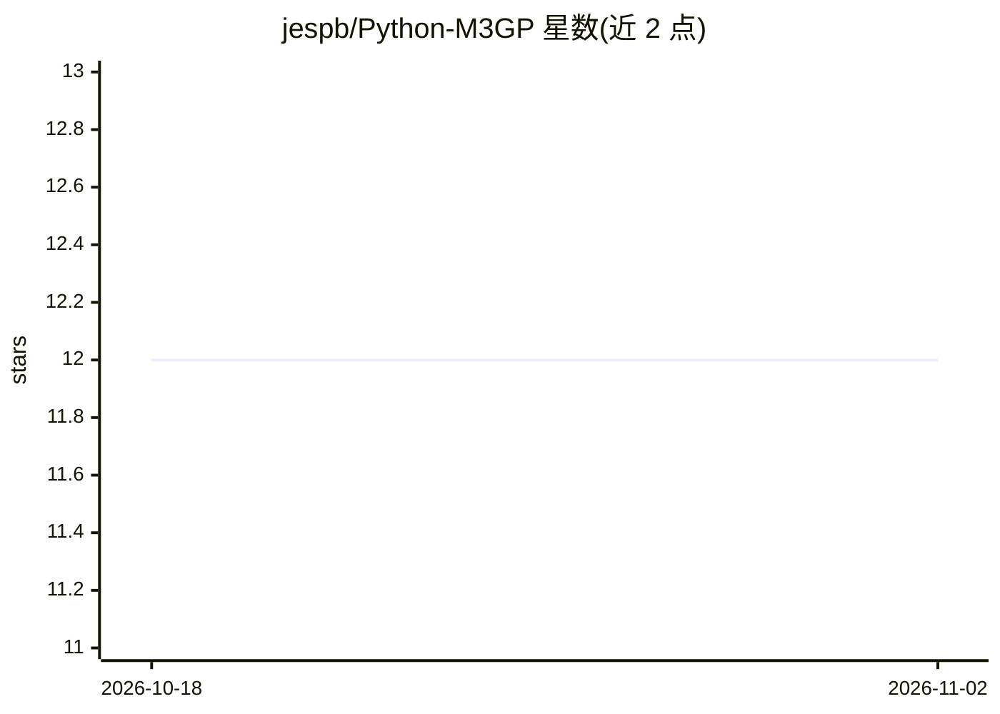

# jespb/Python-M3GP

⭐ 12 · Python · 推送 2026-06-02 · [GitHub](https://github.com/jespb/Python-M3GP) · 个人维护

**M3GP 遗传规划多分类算法的 scikit-learn 风格 Python 实现**

提供 M3GP（多维多种群遗传规划）算法的 Python 实现，通过遗传规划进行自动特征构造并完成多分类/聚类任务，接口仿照 scikit-learn（fit/predict）。支持通过 pip 安装或复制 m3gp 目录导入，也提供带命令行参数的独立运行脚本（数据集、种群规模、代数、维度范围、随机种子等均可配置）。内部默认使用基于马氏距离的分类器，可替换为随机森林等 scikit-learn 模型并支持自定义适应度函数。README 提示 M3GP 训练速度较慢，建议适应度函数随特征数良好扩展。附三篇相关论文的引用信息。

## 筛选速览

| 维度 | 判定 | 备注 |
|---|---|---|
| AI 角色 | `ai-native` | 本体是模型或模型工具 |
| 许可风险 | `none` | — |
| 部署形态 | `library` | 以包/库形式分发 |
| 模型依赖 | — | README 未给出锁定关系 |
| 硬件要求 | — | 无带数字的原话,不猜 |
| 安装摩擦 | `low` | 无编译、无系统依赖或容器化 |
| 成熟度 | — | 结构信号不足 |

## 能力要点

- 遗传规划自动特征构造 + 多分类，fit/predict 接口
- 独立运行脚本支持 15 个命令行参数（种群规模、代数、维度范围、线程数等）
- 可替换内部分类器（默认 MahalanobisDistanceClassifier，可用 RandomForestClassifier）与自定义适应度函数

## 适用场景

- 在分类任务中用遗传规划做自动特征构造
- 复现或扩展 M3GP 算法进行科研实验
- 批量跑多个 CSV 数据集对比分类效果

## 场景标签

 · 领域:机器学习/进化计算

## 证据(README 行号)

> L1: This is a, easy-to-use, scikit-learn inspired version of the M3GP algorithm.
> L121:  $ model.predict(X) -> Returns a list with the prediction of the given dataset.

## 星数曲线

2026-10-18 12 → 2026-11-02 12（+0）

---
*卡片 v1 · prompt 1.4 · 生成 2026-11-01 · 置信度 high · 依据 README sha `f70bce527ff2` · [字段定义](../../DATASET.md)*
