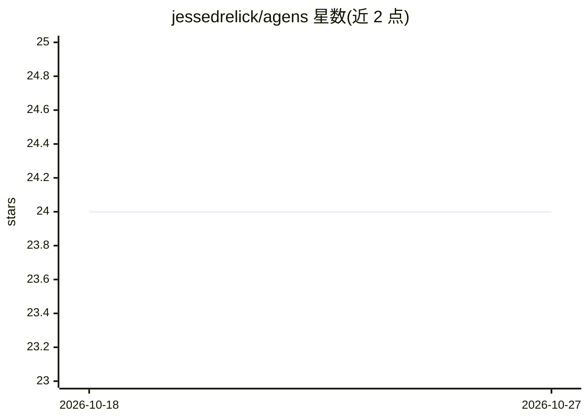

# jessedrelick/agens

⭐ 24 · Elixir · Apache-2.0 · 推送 2026-05-25 · [GitHub](https://github.com/jessedrelick/agens) · 个人维护

**Elixir 多智能体工作流构建框架（基于 OTP）**

面向 Elixir 开发者的多智能体工作流框架，利用 BEAM/OTP 的 GenServer 与 Supervisor 构建由语言模型驱动的 Job 图。核心组件为 Serving（LM 接口，后端无关，支持 OpenAI/Anthropic/Ollama 及 Nx.Serving/Bumblebee 本地管线）、Router（图式/顺序式/LM 驱动的动态路由）、Job（Node 图）与可插拔 Backend（可观测性）。提供结构化输出、MCP 风格工具调用、子 Job、并发限制与 JSON 定义的 Job。v0.2 相对 0.1 有重大破坏性变更。以 Hex 依赖形式安装，Apache-2.0 许可。

## 筛选速览

| 维度 | 判定 | 备注 |
|---|---|---|
| AI 角色 | `ai-ecosystem` | LLM/agent 周边工具 |
| 许可风险 | `permissive` | Apache-2.0 |
| 部署形态 | `None` |  |
| 模型依赖 | local-ok | 支持本地模型 |
| 硬件要求 | — | 无带数字的原话,不猜 |
| 安装摩擦 | `low` | 无编译、无系统依赖或容器化 |
| 成熟度 | — | 结构信号不足 |

## 能力要点

- LM 无关的 Serving 抽象：外部 API（OpenAI/Anthropic/Ollama）或本地 Nx.Serving/Bumblebee 管线
- 图式/顺序式/LM 驱动的动态路由（Agens.Router behaviour）
- MCP 风格工具调用与资源加载，子 Job 层级组合
- 内置 FIFO 队列与 per-Serving 并发限制，Telemetry 指标输出

## 适用场景

- 在 Elixir/Phoenix 应用中编排多 LLM 智能体工作流
- 构建需要有界并发与容错（OTP 监督树）的 LM 自动化流程
- 通过 JSON 配置在运行时加载工作流

## 场景标签

`多智能体` `工作流自动化` `Agent 框架` · 领域:Agent 开发

## 证据(README 行号)

> L6: __Agens__ is an Elixir application designed to build multi-agent workflows with language models.
> L8: Drawing inspiration from popular tools in the Python ecosystem, such as LangChain/LangGraph and CrewAI, __Agens__ sh
> L23: - **LM-agnostic Servings** — call any backend (external APIs like OpenAI, Anthropic, Ollama, or local pipelines lik

## 星数曲线

2026-10-18 24 → 2026-10-27 24（+0）

---
*卡片 v1 · prompt 1.4 · 生成 2026-10-27 · 置信度 high · 依据 README sha `212114edd353` · [字段定义](../../DATASET.md)*
