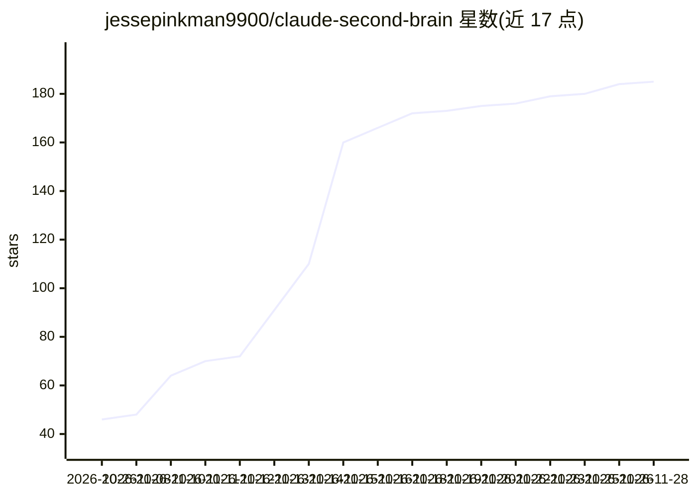

# jessepinkman9900/claude-second-brain

⭐ 185 · JavaScript · MIT · 推送 2026-11-27 · [GitHub](https://github.com/jessepinkman9900/claude-second-brain) · [官网](https://jessepinkman9900.github.io/claude-second-brain/) · 个人维护

**一条命令搭建 AI agent 维护的 Obsidian 个人知识库**

CLI 脚手架工具：运行 npx claude-second-brain 后生成一个 Obsidian vault 结构的 wiki 目录，注册 qmd 本地混合检索（向量+BM25）集合，初始化 git 仓库，并按用户选择的 agent 安装 /brain-ingest、/brain-search、/brain-refresh 等 slash 命令技能。用户的 AI coding agent 读取 CLAUDE.md/AGENTS.md 中的 schema 来摄取文献、交叉链接页面、生成带 [[wiki 链接]] 引用的回答。首次嵌入需下载约 2GB GGUF 模型。要求 Node 22+/pnpm 10+（或 mise），Obsidian 为可选组件。

## 筛选速览

| 维度 | 判定 | 备注 |
|---|---|---|
| AI 角色 | `ai-native` | 本体是模型或模型工具 |
| 许可风险 | `permissive` | MIT |
| 部署形态 | `library` | 以包/库形式分发 |
| 模型依赖 | local-ok | 支持本地模型 |
| 硬件要求 | — | 无带数字的原话,不猜 |
| 安装摩擦 | `low` | 无编译、无系统依赖或容器化 |
| 成熟度 | — | 结构信号不足 |

## 能力要点

- npx 一条命令生成预配置知识库：qmd 检索、git 远端、Obsidian vault、agent 技能一次到位
- 5 种结构化页面类型（overview/topic/entity/source-summary/qa），YAML frontmatter 与 [[wikilinks]] 交叉链接
- 遵循开放 Agent Skills 格式，同一套技能可安装到 Claude Code、Codex、Cursor、Copilot、Gemini CLI 等多种 agent
- /brain-search 输出带行内 wiki 引用的合成回答；/lint 检查孤儿页、断链与矛盾

## 适用场景

- 把多年积累的论文、文章、书籍投喂给 agent，自动生成交叉链接的 wiki
- 半年后提问仍能获得带出处引用的回答，而非文件列表
- 借助 obsidian-git 与私有 GitHub 仓库在多设备同步与访问知识库
- 用 /lint 定期体检 wiki，修复断链与未解决的矛盾

## 场景标签

`知识库管理` `科研工具` `RAG` `文档问答` · 领域:知识与检索

## 证据(README 行号)

> L13: One command gives you a fully wired knowledge system:
> L19: You've been reading papers, articles, and books for years. Drop a source in, run `/brain-ingest`, and your agent re
> L107: The wiki skills follow the open Agent Skills format, so the same `/brain-ingest`, `/brain-search`, `/brain-refresh

## 星数曲线

2026-10-26 46 → 2026-11-28 185（+139）

---
*卡片 v1 · prompt 1.4 · 生成 2026-11-28 · 置信度 high · 依据 README sha `d1ba292bf273` · [字段定义](../../DATASET.md)*
