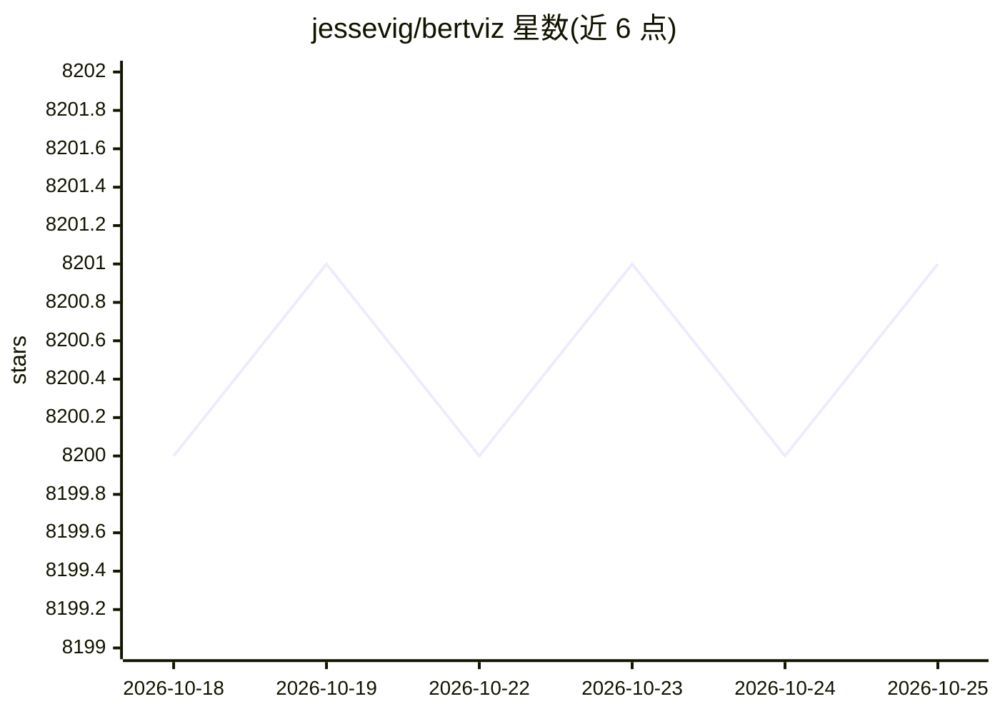

# jessevig/bertviz

⭐ 8,201 · Python · Apache-2.0 · 推送 2026-01-08 · [GitHub](https://github.com/jessevig/bertviz) · 个人维护

**可视化 Transformer 模型注意力机制的 Jupyter 交互工具**

在 Jupyter/Colab 中运行的 Python 工具，通过 Python API 读取 Huggingface 模型的注意力权重并生成交互式可视化，提供 head view（单层多头）、model view（全层全景）和 neuron view（query/key 向量神经元）三种视图；支持自注意力模型与编码器-解码器模型（BART、T5 等），可导出 HTML。限制：长文本或大模型下运行缓慢，neuron view 仅支持内置的 BERT/GPT-2/RoBERTa 定制版本。面向 NLP 研究者与模型开发者。

## 筛选速览

| 维度 | 判定 | 备注 |
|---|---|---|
| AI 角色 | `ai-ecosystem` | LLM/agent 周边工具 |
| 许可风险 | `permissive` | Apache-2.0 |
| 部署形态 | `library` | 以包/库形式分发 |
| 模型依赖 | — | README 未给出锁定关系 |
| 硬件要求 | — | 无带数字的原话,不猜 |
| 安装摩擦 | `low` | 无编译、无系统依赖或容器化 |
| 成熟度 | — | 结构信号不足 |

## 能力要点

- 三种注意力视图：head view / model view / neuron view
- 支持多数 Huggingface 模型及编码器-解码器（BART、T5 等）
- 可返回 HTML 对象用于保存或自定义展示
- 提供 Interactive Colab 教程与示例 notebook

## 适用场景

- 分析 BERT/GPT-2 等模型的注意力分布
- 研究跨层、跨头的注意力全景结构
- 对比编码器、解码器与交叉注意力

## 场景标签

`教程课程` · 领域:学习与行业

## 证据(README 行号)

> L10: BertViz is an interactive tool for visualizing attention in Transformer language models. It can be run inside a Jup
> L11:  notebook through a simple Python API that supports most Huggingface models. BertViz extends the

## 星数曲线

2026-10-18 8,200 → 2026-10-25 8,201（+1）

---
*卡片 v1 · prompt 1.4 · 生成 2026-10-20 · 置信度 high · 依据 README sha `038541038a30` · [字段定义](../../DATASET.md)*
