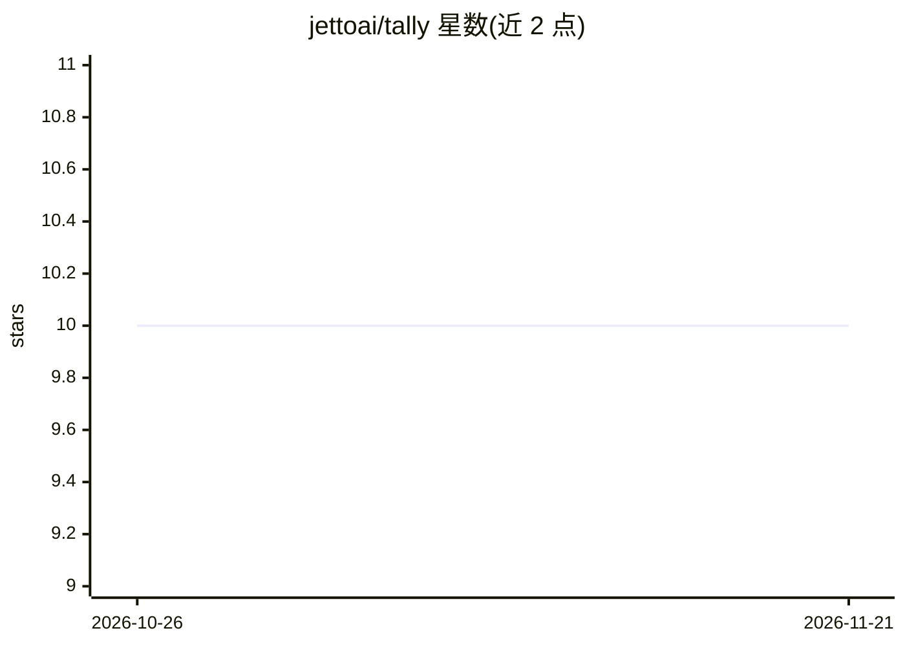

# jettoai/tally

⭐ 10 · Swift · MIT · 推送 2026-11-16 · [GitHub](https://github.com/jettoai/tally) · [官网](https://github.com/jettoai/tally/releases/latest/download/Tally.dmg) · 组织维护

**macOS 菜单栏应用：并排显示多个 Claude/Codex 账号用量额度**

免费开源的原生 Swift macOS 菜单栏应用，读取本机已登录的多个 Claude Pro/Max 与 Codex 付费订阅账号的 5 小时、每周及最高模型额度窗口并排展示，把每个提供商的账号合并为一个池并预估耗尽时间。通过官方 claude/codex CLI 读取用量（只读），不代理、不记录令牌；附带 tally 命令行启动器，可将新会话启动到剩余额度最多的账号，额度耗尽时在同一会话上切换账号，并提供会话看板与按项目的 token/花费统计。

## 筛选速览

| 维度 | 判定 | 备注 |
|---|---|---|
| AI 角色 | `ai-ecosystem` | LLM/agent 周边工具 |
| 许可风险 | `permissive` | MIT |
| 部署形态 | `desktop` | 安装包/桌面程序 |
| 模型依赖 | — | README 未给出锁定关系 |
| 硬件要求 | — | 无带数字的原话,不猜 |
| 安装摩擦 | `medium` | 含编译或系统依赖之一 |
| 成熟度 | — | 结构信号不足 |

## 能力要点

- 多个账号额度并排展示并合并为提供商预算池
- tally claude/codex 启动剩余额度最多的账号，额度耗尽时延续同一会话
- 用量通过官方 CLI（claude -p "/usage"、codex app-server）读取，只读且不上传令牌
- 按项目读取本地会话记录统计 token 与清单价花费

## 适用场景

- 在一台 Mac 上同时管理多个 Claude Pro/Max 订阅并监控用量
- 让 AI 编码会话自动分配到剩余额度最多的账号
- 按项目查看 token 消耗与花费明细

## 场景标签

 · 领域:开发工具/AI 用量管理

## 证据(README 行号)

> L9:  A free, open-source macOS menu bar app. It shows the 5-hour, weekly and top-model limits of every account side by s
> L28: `tally claude` (or `tally codex`) weighs remaining quota against reset time. When an account hits its cap, Tally re
> L58: Or download the DMG directly, drag **Tally.app** into Applications, and launch it. It is notarized and updates itse

## 星数曲线

2026-10-26 10 → 2026-11-21 10（+0）

---
*卡片 v1 · prompt 1.4 · 生成 2026-11-19 · 置信度 high · 依据 README sha `3ad1f665f15b` · [字段定义](../../DATASET.md)*
