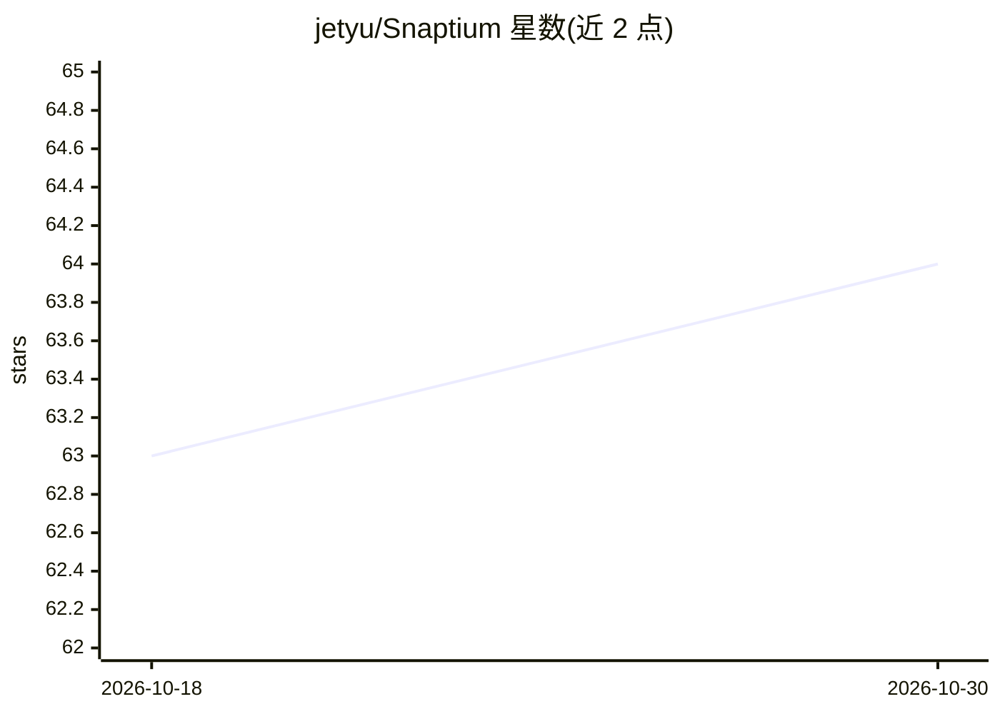

# jetyu/Snaptium

⭐ 64 · TypeScript · Apache-2.0 · 推送 2026-10-25 · [GitHub](https://github.com/jetyu/Snaptium) · [官网](https://snaptium.com) · 个人维护 · 中文 README

**本地优先的跨平台 Markdown 笔记应用，带 AI 助手与知识库问答**

基于 Electron/Vue 3 与 CodeMirror 6 的桌面笔记应用，覆盖 Windows/macOS/Linux。核心为 Markdown 编辑（KaTeX、Mermaid、代码高亮），AI 能力包括写作助手（三档强度、五种风格、七类场景）与基于 LangChain+LanceDB 的本地向量知识库，支持 RAG 问答与 Agent 模式、全文+语义混合搜索。兼容云端服务与本地 Ollama，支持 12+ 模型接入（BYOK），AI 功能默认关闭需用户配置。笔记本地存储，提供 AES-256-GCM 加密与 WebDAV/S3 端到端加密同步。

## 筛选速览

| 维度 | 判定 | 备注 |
|---|---|---|
| AI 角色 | `ai-enhanced` | 去掉 AI 部分产品仍成立 |
| 许可风险 | `permissive` | Apache-2.0 |
| 部署形态 | `desktop` | 安装包/桌面程序 |
| 模型依赖 | local-ok | 支持本地模型 |
| 硬件要求 | — | 无带数字的原话,不猜 |
| 安装摩擦 | `low` | 无编译、无系统依赖或容器化 |
| 成熟度 | — | 结构信号不足 |

## 能力要点

- 本地向量知识库（LanceDB）与 Ask/Agent 模式的 RAG 问答
- BYOK 支持 12+ 模型提供方，含本地 Ollama，AI 功能默认关闭
- 端到端加密同步：WebDAV、Amazon S3、Cloudflare R2、MinIO、NAS
- Markdown/ENEX 导入导出与版本历史、回收站恢复

## 适用场景

- 长期写作并建立可语义检索的个人知识库
- 在笔记中直接向 AI 提问，基于自己的笔记内容获得回答
- 多设备间通过自托管存储端到端加密同步笔记
- 国内网络下接入 DeepSeek/通义/Kimi 等模型做笔记辅助

## 场景标签

`知识库管理` `文档问答` `语义搜索` `AI 写作` · 领域:内容生成

## 证据(README 行号)

> L26: Snaptium is a cross-platform AI Markdown note-taking and knowledge management app. It combines a CodeMirror 6 edito
> L57: |🤖 AI writing assistant|Three assistance intensities, five writing styles, and seven scenarios for technical docume
> L71: > AI features are disabled by default. Models and API access are configured explicitly by the user.

## 星数曲线

2026-10-18 63 → 2026-10-30 64（+1）

---
*卡片 v1 · prompt 1.4 · 生成 2026-10-24 · 置信度 high · 依据 README sha `db66e93928e6` · [字段定义](../../DATASET.md)*
