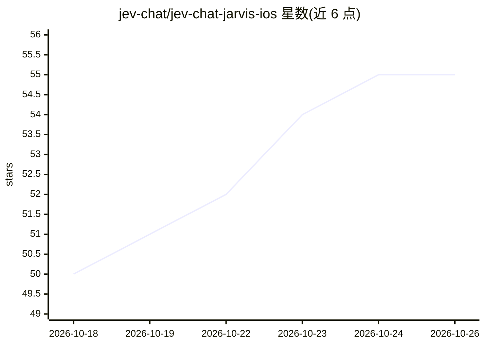

# jev-chat/jev-chat-jarvis-ios

⭐ 55 · Swift · MIT · 推送 2026-10-22 · [GitHub](https://github.com/jev-chat/jev-chat-jarvis-ios) · 个人维护 · 中文 README

**iOS 自定义键盘：在聊天 App 内分析消息意图/风险并生成候选回复**

面向聊天用户的 iOS 键盘扩展：长按复制对方消息后，键盘上显示 8 类意图概率、0-9 风险、行动建议与候选回复，点按插入输入框，发送由用户手动完成。生成层与判断层由用户自行配置 OpenAI/Anthropic 兼容接口与 API Key，App 不提供生成服务。可选直播模式通过广播扩展在本机 Vision OCR 读屏，识别结果仅在用户触发分析时发往所配模型。以 Xcode 工程源码形式提供，需 Mac 自行编译签名安装。

## 筛选速览

| 维度 | 判定 | 备注 |
|---|---|---|
| AI 角色 | `ai-native` | 本体是模型或模型工具 |
| 许可风险 | `permissive` | MIT |
| 部署形态 | `None` |  |
| 模型依赖 | — | README 未给出锁定关系 |
| 硬件要求 | — | 无带数字的原话,不猜 |
| 安装摩擦 | `medium` | 含编译或系统依赖之一 |
| 成熟度 | — | 结构信号不足 |

## 能力要点

- 键盘扩展内输出意图分布、风险评分、行动建议与候选回复
- 可选直播模式：广播扩展本机 OCR 读屏，免复制
- 2 个话术槽位、内置 12 种话术，每话术出 2 条候选（前稳后放）
- 生成层/判断层均由用户自配 API Key，无自建服务器、不落盘

## 适用场景

- 聊天中收到拿不准的消息，复制后直接在键盘上看意图和风险
- 在任意聊天 App 里让键盘按指定话术代拟回复
- 不逐条复制时用直播模式读屏分析对话并挑消息回复

## 场景标签

`AI 写作` · 领域:内容生成

## 证据(README 行号)

> L10: 聊天 App 收到一条消息 → 在**当前聊天 App 的键盘上**直接看到这句话的**意图、风险**和**候选回复**，点一下就进输入框。
> L45: 3. 键盘上显示：意图 + 风险 0-9 + 行动建议 + 每话术 2 条候选（前稳后放）

## 星数曲线

2026-10-18 50 → 2026-10-26 55（+5）

---
*卡片 v1 · prompt 1.4 · 生成 2026-10-24 · 置信度 high · 依据 README sha `76f301951ea2` · [字段定义](../../DATASET.md)*
