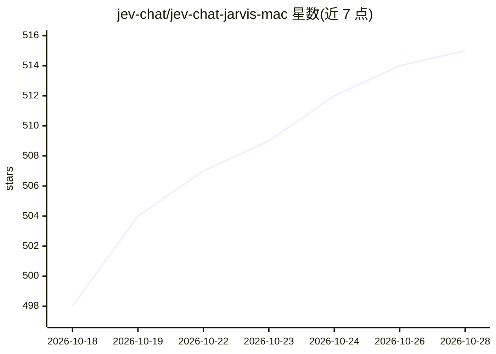

# jev-chat/jev-chat-jarvis-mac

⭐ 517 · Python · MIT · 推送 2026-10-12 · [GitHub](https://github.com/jev-chat/jev-chat-jarvis-mac) · 个人维护 · 中文 README

**macOS 聊天悬浮窗助手：读屏识别消息，本地模型判意图风险并给候选回复**

面向 macOS 用户的纯只读聊天辅助工具：悬浮窗跟随前台聊天应用，通过窗口截图+Apple Vision OCR 或系统文本接口读取消息，区分正文、昵称、公告与引用，仅对确认来自对方的消息触发分析。本地小模型（decider-2b，约 3.8 GB）一次前向输出 8 类意图、0–9 风险分级与行动建议，生成层可配置 OpenAI/Anthropic 兼容服务、Jev、DeepSeek、本地 Ollama 等，按 14 种话术生成候选回复并由本地模型排序，用户手动复制或填入。仅支持 Apple Silicon、macOS 13+；需屏幕录制与辅助功能权限；不发送消息、不读取聊天数据库。

## 筛选速览

| 维度 | 判定 | 备注 |
|---|---|---|
| AI 角色 | `ai-native` | 本体是模型或模型工具 |
| 许可风险 | `permissive` | MIT |
| 部署形态 | `None` |  |
| 模型依赖 | local-ok | 支持本地模型 |
| 硬件要求 | — | 无带数字的原话,不猜 |
| 安装摩擦 | `low` | 无编译、无系统依赖或容器化 |
| 成熟度 | — | 结构信号不足 |

## 能力要点

- 截图 OCR 与系统文本接口双路径读取消息，区分正文/昵称/公告/引用
- 本地 decider-2b 模型输出意图（8 类）、风险分级与行动建议
- 14 种内置话术并发生成候选回复，本地模型排序，话术可自定义
- 生成层支持 OpenAI/Anthropic 兼容、Jev、DeepSeek、Ollama 等多来源配置

## 适用场景

- 收到聊天消息时快速查看对方意图与风险等级
- 按不同话术获得候选回复，自行选择填入或复制
- 本地模型离线判断，不依赖云端服务（生成层可选本地 Ollama）

## 场景标签

`AI 助手` · 领域:对话与助手

## 证据(README 行号)

> L3: 聊天应用弹出一条消息 → 悬浮窗立刻告诉你**这句话的真实意图**、**风险几级**、**该怎么回**。
> L24: - **意图 + 风险**：8 类意图零样本 **86.4%**（22 条回归口径），风险 0–9 分级 + 行动建议，本地模型一次前向出全分布
> L25: - **候选回复**：内置 14 种话术并发生成（含恋爱向「狗头军师」三件套：稳健 / 会撩 / 抽离；每种话术候选数 1—5 条可配置，默认 2 条）→ 先上屏 → 本地模型排序后原位重排；换话术立刻按当前消息重新生成

## 星数曲线

2026-10-18 498 → 2026-10-28 515（+17）

---
*卡片 v1 · prompt 1.4 · 生成 2026-10-21 · 置信度 high · 依据 README sha `00e152d4cf26` · [字段定义](../../DATASET.md)*
