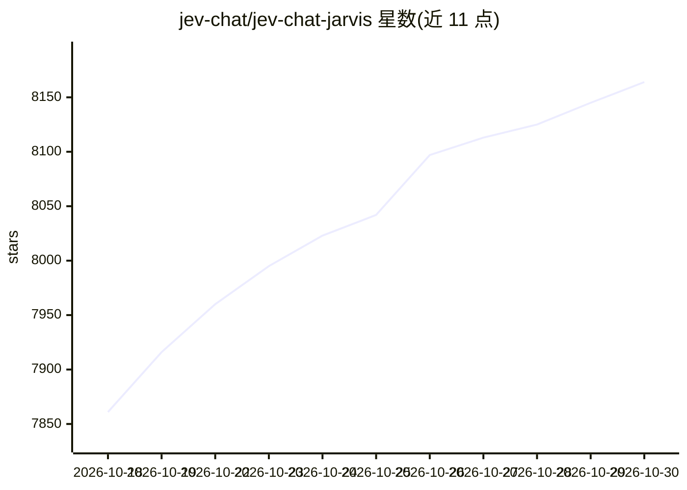

# jev-chat/jev-chat-jarvis

⭐ 8,164 · Kotlin · MIT · 推送 2026-10-16 · [GitHub](https://github.com/jev-chat/jev-chat-jarvis) · [官网](https://chatjevs.com) · 组织维护 · 中文 README

**聊天回复决策助手：先判断对方意图与风险，再起草回复供你发送**

面向终端用户的聊天辅助工具：读取屏幕上的对话（Android 无障碍服务、桌面截图+端上 OCR、iOS 复制消息），先用判断模型分析对方意图、当下风险与应对方式，再起草多条经校验排序的回复，一键填入输入框，由用户自行发送。支持 WhatsApp/QQ/飞书/X 等应用；请求仅发往用户自行配置的模型服务商，项目方不运行服务器。跨 Android/Windows/macOS/iOS 提供 5 个应用，Android 双版本在本仓库，iOS 仅源码。在第三方应用内使用可能违反其服务条款。

## 筛选速览

| 维度 | 判定 | 备注 |
|---|---|---|
| AI 角色 | `ai-native` | 本体是模型或模型工具 |
| 许可风险 | `permissive` | MIT |
| 部署形态 | `desktop` | 安装包/桌面程序 |
| 模型依赖 | — | README 未给出锁定关系 |
| 硬件要求 | — | 无带数字的原话,不猜 |
| 安装摩擦 | `low` | 无编译、无系统依赖或容器化 |
| 成熟度 | `idea` | |

## 能力要点

- 先判断意图/风险再起草回复，草稿经校验并排序
- Android 无障碍服务、桌面 OCR、iOS 键盘多端读取方式
- 请求仅发往用户配置的模型服务商，自备 key，无官方服务器
- 只填入输入框、不代发消息

## 适用场景

- 拿不准对方意图或语气风险时，先看分析再决定怎么回
- 在 WhatsApp/QQ 等聊天中快速获得多条候选回复并一键填入
- 关注隐私的用户希望聊天数据只发往自己配置的模型服务

## 场景标签

`AI 助手` · 领域:对话与助手

## 证据(README 行号)

> L38: **jev-chat** judges first. Its Jev judgment model reads the conversation and works out the other person's intent, t
> L98: 1. **Read.** Jev reads the conversation on your screen: through the accessibility service on Android, the chat wind
> L99: 2. **Judge first.** Before any reply is written, a judgment model works out what the other person really wants, how

## 星数曲线

2026-10-18 7,861 → 2026-10-30 8,164（+303）

---
*卡片 v1 · prompt 1.4 · 生成 2026-10-18 · 置信度 high · 依据 README sha `e5fbc52ea978` · [字段定义](../../DATASET.md)*
