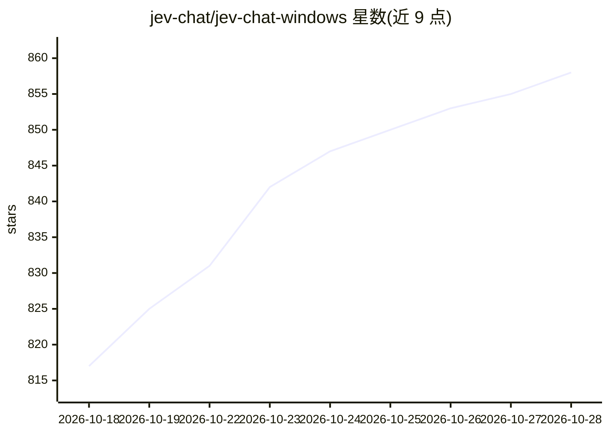

# jev-chat/jev-chat-windows

⭐ 858 · Python · NOASSERTION · 推送 2026-09-28 · [GitHub](https://github.com/jev-chat/jev-chat-windows) · 个人维护 · 中文 README

**Windows 聊天窗口旁挂的 AI 回复辅助：OCR 读屏生成候选回复**

面向个人聊天用户的 Windows 桌面工具：用 Windows Graphics Capture 截取微信或 KakaoTalk 聊天窗口，本地离线 OCR（RapidOCR 或系统 OCR）识别对方消息，先由 Jev 模型判断意图/紧张度，再由语言模型起草 3 条候选回复一键填入输入框，发送始终由用户手动完成。需要两把 API key（判断走 OpenRouter 或 TypeSafe，起草默认 DeepSeek，支持 12 家来源）。仅限 Windows 10 1903+ / 11，提供打包好的 exe 下载，也可源码运行。

## 筛选速览

| 维度 | 判定 | 备注 |
|---|---|---|
| AI 角色 | `ai-native` | 本体是模型或模型工具 |
| 许可风险 | `none` | NOASSERTION |
| 部署形态 | `desktop` | 安装包/桌面程序 |
| 模型依赖 | locked-api |  |
| 硬件要求 | — | 无带数字的原话,不猜 |
| 安装摩擦 | `low` | 无编译、无系统依赖或容器化 |
| 成熟度 | — | 结构信号不足 |

## 能力要点

- 窗口截图 + 本地离线 OCR 采集，不 hook、不注入、截图不落盘
- 三段式链路：Jev 判断意图 → LLM 起草 3 条候选 → Jev 排序给胜出概率
- 起草支持 12 家来源，OpenAI / Anthropic / Gemini 三种协议，可自填 Base URL
- 群聊支持发言人识别与指定回复对象，按会话分开存记录与候选

## 适用场景

- 聊天时让 AI 生成几条候选回复，自己挑选修改后发送
- 在群聊中针对指定对象生成带 @ 前缀的候选回复
- 通过悬浮窗查看对方意图判断摘要（建议动作、紧张度 0–9）

## 场景标签

`OCR` `AI 助手` `AI 写作` · 领域:对话与助手

## 证据(README 行号)

> L11: 聊天窗口旁挂的回复辅助：本地 OCR 读屏上的对话 → Jev 判断意图/情绪 → 给出 3 条候选回复 →
> L204: 两节各一把 key，都必填。链路是**三段式**（issue #4）：先让 Jev 答 7 道判断题，把
> L23: 1. 在 Releases 页下载 `jev-chat-windows-vX.Y.Z.zip`（约 146 MB）

## 星数曲线

2026-10-18 817 → 2026-10-28 858（+41）

---
*卡片 v1 · prompt 1.4 · 生成 2026-10-21 · 置信度 mid · 依据 README sha `074b806a0a15` · [字段定义](../../DATASET.md)*
