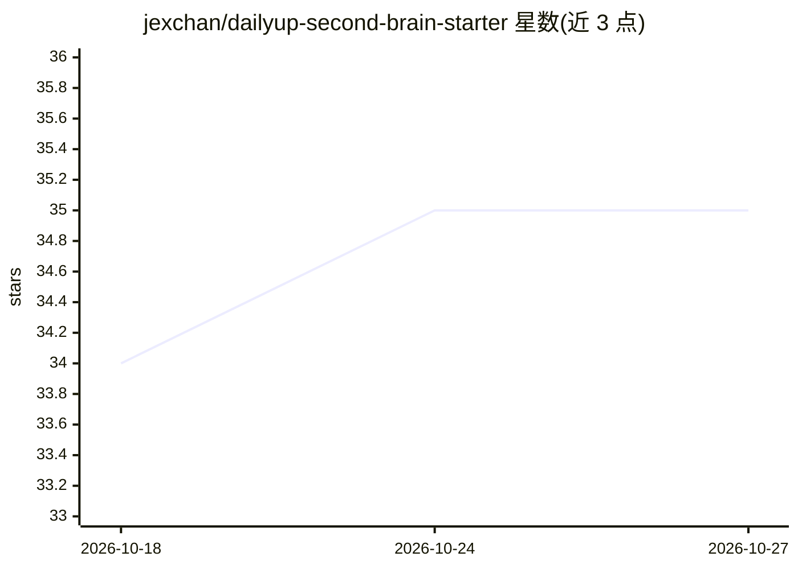

# jexchan/dailyup-second-brain-starter

⭐ 35 · Python · NOASSERTION · 推送 2026-08-04 · [GitHub](https://github.com/jexchan/dailyup-second-brain-starter) · 个人维护 · 中文 README

**面向人机长期协作的 Obsidian 第二大脑模板**

一套可直接使用的 Obsidian Vault 框架：8 个主目录的信息架构、22 种原子化卡片模板、16 个开箱即用的 AI 技能（/today、/digest、/weekly-review、/card-creator 等）、Obsidian Bases 数据库视图，以及完整的写作/命名/任务管理规则。通过 CLAUDE.md + AGENTS.md 通用协议，任何支持该协议的 AI 编码工具（Claude Code、Cursor、Codex 等）可接入并理解知识库。必备 Obsidian 与 Git；模板本身开源免费，另有配套付费视频课程。

## 筛选速览

| 维度 | 判定 | 备注 |
|---|---|---|
| AI 角色 | `ai-enhanced` | 去掉 AI 部分产品仍成立 |
| 许可风险 | `none` | NOASSERTION |
| 部署形态 | `None` |  |
| 模型依赖 | — | README 未给出锁定关系 |
| 硬件要求 | — | 无带数字的原话,不猜 |
| 安装摩擦 | `low` | 无编译、无系统依赖或容器化 |
| 成熟度 | — | 结构信号不足 |

## 能力要点

- 8 个主目录信息架构 + 22 种原子化卡片模板
- 16 个开箱即用的 AI 技能（位于 .agents/skills/）
- 基于 CLAUDE.md/AGENTS.md 协议接入任意兼容 AI 编码工具
- Obsidian Bases 数据库视图（Books、Persons、Resources 等）

## 适用场景

- 搭建长期使用的个人第二大脑知识库
- 用 AI 编码工具做日记复盘、剪藏消化与卡片创建
- 通过 Topics 主题地图维护长期关注领域的知识连接

## 场景标签

`知识库管理` · 领域:知识与检索

## 证据(README 行号)

> L13: - **16 个开箱即用的 AI 技能（Skills）** — `/today`、`/digest`、`/weekly-review`、`/reading-coach`、`/card-creator` 等
> L14: - **完整的 AI 协作规则** — CLAUDE.md + AGENTS.md 让任意支持该协议的 AI 编码工具立刻理解你的知识库
> L113: > 本模板基于 `AGENTS.md` / `CLAUDE.md` 通用协议，理论上任何支持该协议的 AI 编码工具（Claude Code、Cursor 等）都能接入；以上只是作者实测顺手的推荐。

## 星数曲线

2026-10-18 34 → 2026-10-27 35（+1）

---
*卡片 v1 · prompt 1.4 · 生成 2026-10-25 · 置信度 mid · 依据 README sha `5a24f24201cc` · [字段定义](../../DATASET.md)*
