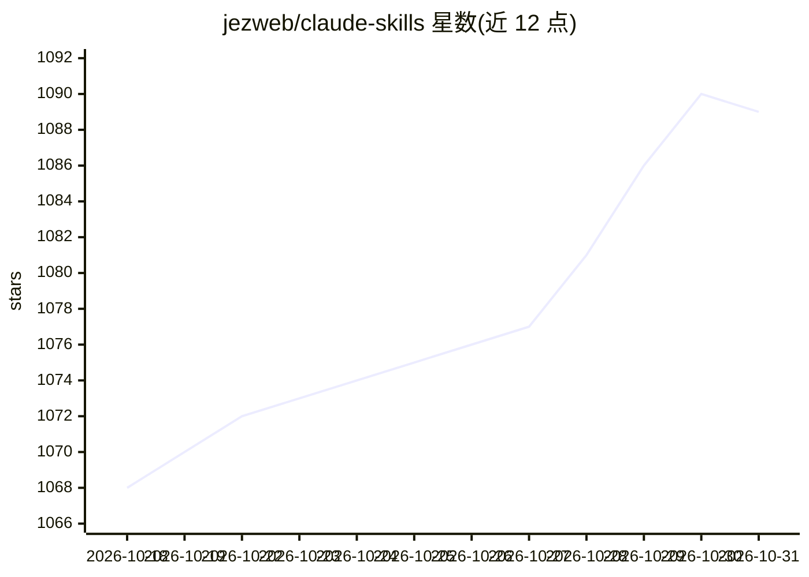

# jezweb/claude-skills

⭐ 1,089 · Python · MIT · 推送 2026-10-09 · [GitHub](https://github.com/jezweb/claude-skills) · [官网](https://jezweb.com.au) · 个人维护

**面向 Claude Code 的生产工作流技能插件合集（10 插件）**

为 Claude Code CLI 提供的技能/插件市场仓库：10 个插件、约 52 个技能，覆盖全栈脚手架（Vite+React+Cloudflare Workers）、Shopify/WordPress/Stripe 集成、Tailwind/shadcn 前端构建、设计资产生成、商务写作与开发工具（文档、git、UX 审计等）。技能以自然语言触发短语激活，哲学为『每个技能必须产出实际产物』。通过 /plugin marketplace add 命令安装；思考类技能另存于 dotjez 框架。v13 收录 11 插件 52 技能，部分 Cloudflare 脚手架已归档。

## 筛选速览

| 维度 | 判定 | 备注 |
|---|---|---|
| AI 角色 | `ai-ecosystem` | LLM/agent 周边工具 |
| 许可风险 | `permissive` | MIT |
| 部署形态 | `None` |  |
| 模型依赖 | — | README 未给出锁定关系 |
| 硬件要求 | — | 无带数字的原话,不猜 |
| 安装摩擦 | `low` | 无编译、无系统依赖或容器化 |
| 成熟度 | — | 结构信号不足 |

## 能力要点

- 10 个插件覆盖构建部署、设计前端、写作文档、开发工具四类
- 技能由自然语言触发短语自动激活
- 涵盖 Shopify/WordPress/Stripe/Google Workspace/ElevenLabs 等集成
- 『每个技能必须产出实际产物』，教模式而非交付脚本

## 适用场景

- 让 Claude Code 一句话脚手架全栈应用并部署到 Cloudflare
- 为电商项目接入 Shopify/Stripe/WordPress 工作流
- 生成商务文档、简历、提案与社媒帖子
- 自动化项目文档、git 发布与 UX 审计流程

## 场景标签

`工作流自动化` `代码生成` `编码 Agent` `AI 写作` · 领域:效率与自动化

## 证据(README 行号)

> L5: Production workflow skills for Claude Code. Each skill guides Claude through a recipe to produce tangible output — s
> L13: /plugin marketplace add jezweb/claude-skills

## 星数曲线

2026-10-18 1,068 → 2026-10-31 1,089（+21）

---
*卡片 v1 · prompt 1.4 · 生成 2026-10-21 · 置信度 high · 依据 README sha `bfb0d0fd3089` · [字段定义](../../DATASET.md)*
