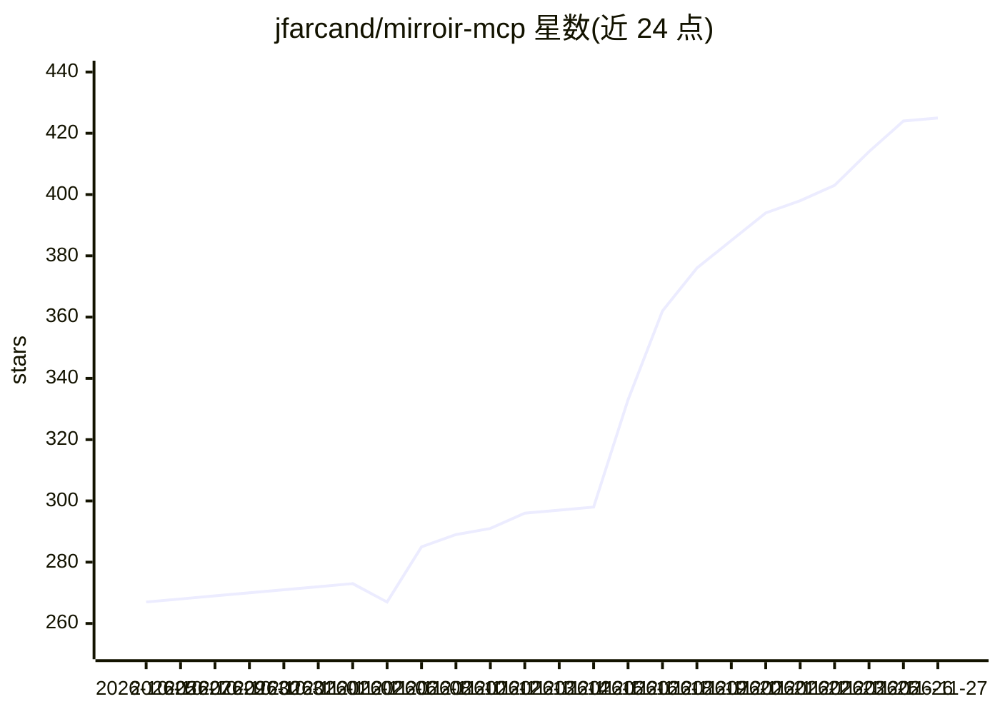

# jfarcand/mirroir-mcp

⭐ 425 · Swift · Apache-2.0 · 推送 2026-11-26 · [GitHub](https://github.com/jfarcand/mirroir-mcp) · [官网](https://mirroir.dev) · 个人维护

**让 AI agent 通过 iPhone Mirroring 操作真实 iPhone 的 MCP 服务器**

基于 macOS iPhone Mirroring 的 MCP 服务器，向 MCP 客户端暴露 43 个工具（点击、输入、滑动、读屏、听音、启动应用等），使 agent 能操作用户自己的 iPhone，无需开发者模式、Xcode 或越狱，手机端不安装任何组件。探索过程可固化为 SKILL.md 技能，编译为无 LLM 参与的确定性回放并在 CI 运行（pass/fail/DRIFT）。默认本地 OCR 读屏，可选 AI vision 模式。默认仅暴露 14 个只读工具，需在 permissions.json 中放行更多。要求 macOS 15+ 与通过 iPhone Mirroring 连接的 iPhone，通过 npx 或 brew 安装。

## 筛选速览

| 维度 | 判定 | 备注 |
|---|---|---|
| AI 角色 | `ai-ecosystem` | LLM/agent 周边工具 |
| 许可风险 | `permissive` | Apache-2.0 |
| 部署形态 | `library` | 以包/库形式分发 |
| 模型依赖 | — | README 未给出锁定关系 |
| 硬件要求 | — | 无带数字的原话,不猜 |
| 安装摩擦 | `low` | 无编译、无系统依赖或容器化 |
| 成熟度 | — | 结构信号不足 |

## 能力要点

- 43 个 MCP 工具驱动 iPhone，手机端零安装、无 OAuth
- 探索生成 SKILL.md 技能，可编译为无 AI 参与的确定性回放接入 CI
- 读屏双模式：本地 Apple Vision OCR（默认）与 AI vision
- 默认只读权限、blockedApps 黑名单、无遥测、kill switch

## 适用场景

- 让编码 agent 代我在手机应用间办事：建歌单、写提醒清单
- 在 CI 中回放技能做移动端自动化测试并检测漂移
- 驱动真实 iPhone 玩游戏或做演示
- 给 MCP 客户端接入手机控制能力而不交出密码

## 场景标签

`编码 Agent` `GUI 自动化` `OCR` · 领域:效率与自动化

## 证据(README 行号)

> L28: No Developer Mode, no Xcode, nothing installed on the phone. mirroir-mcp drives your iPhone through macOS iPhone Mi
> L50: your agent ──MCP──▶ mirroir ──iPhone Mirroring──▶ your iPhone
> L72: - **Tools.** 43 MCP tools: tap, type, swipe, read the screen, listen, launch, and `run_steps` to repeat a sequence 

## 星数曲线

2026-10-25 267 → 2026-11-27 425（+158）

---
*卡片 v1 · prompt 1.4 · 生成 2026-11-27 · 置信度 high · 依据 README sha `289da4b7c5ca` · [字段定义](../../DATASET.md)*
