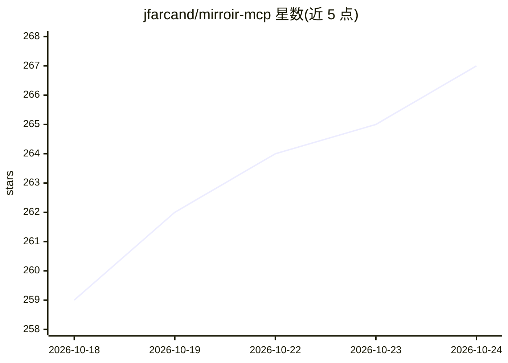

# jfarcand/mirroir-mcp

⭐ 267 · Swift · Apache-2.0 · 推送 2026-10-23 · [GitHub](https://github.com/jfarcand/mirroir-mcp) · [官网](https://mirroir.dev) · 个人维护

**让 AI agent 通过 macOS 镜像操控真机 iPhone 的 MCP 服务器**

面向 MCP 客户端的 Swift 服务器：借助 macOS iPhone Mirroring 让 AI agent 读取屏幕（Apple Vision OCR 文本、可选 YOLO CoreML 图标检测、可选 embacle AI 视觉模式）并执行 tap/swipe/输入等 38 个工具，形成观察-推理-行动循环；实验性支持 macOS 窗口。提供 BFS 自动探索 App 生成 SKILL.md 技能、录制回放与游戏 QA 冒烟测试流程，支持 APP.md 描述应用结构。要求 macOS 15+ 且 iPhone 已连接 Mirroring；单指针限制使多点触控游戏不可用。

## 筛选速览

| 维度 | 判定 | 备注 |
|---|---|---|
| AI 角色 | `ai-ecosystem` | LLM/agent 周边工具 |
| 许可风险 | `permissive` | Apache-2.0 |
| 部署形态 | `library` | 以包/库形式分发 |
| 模型依赖 | locked-api |  |
| 硬件要求 | — | 无带数字的原话,不猜 |
| 安装摩擦 | `low` | 无编译、无系统依赖或容器化 |
| 成熟度 | `idea` | |

## 能力要点

- 38 个工具：describe_screen OCR + tap/type/swipe + 系统手势与生命周期控制
- BFS 自动探索 App 并生成 SKILL.md 技能，结构指纹去重
- 三种屏幕识别后端：Apple Vision OCR / YOLO CoreML 图标检测 / embacle AI 视觉（经已认证 CLI 路由，无独立 API key）
- 游戏 shell 界面覆盖与区域/缩放截图以降低 token 成本

## 适用场景

- 用自然语言让 agent 在真机 iPhone 上执行 App 测试流程
- 自动探索 App 生成可复用的测试技能（SKILL.md）
- 游戏 QA 冒烟测试、教程走查与脚本化演示

## 场景标签

`GUI 自动化` · 领域:效率与自动化

## 证据(README 行号)

> L14: Give your AI eyes, hands, and a real iPhone. An MCP server that lets any AI agent see the screen, tap what it needs
> L103: ## How it works

## 星数曲线

2026-10-18 259 → 2026-10-24 267（+8）

---
*卡片 v1 · prompt 1.4 · 生成 2026-10-22 · 置信度 high · 依据 README sha `92b6cc0ca572` · [字段定义](../../DATASET.md)*
