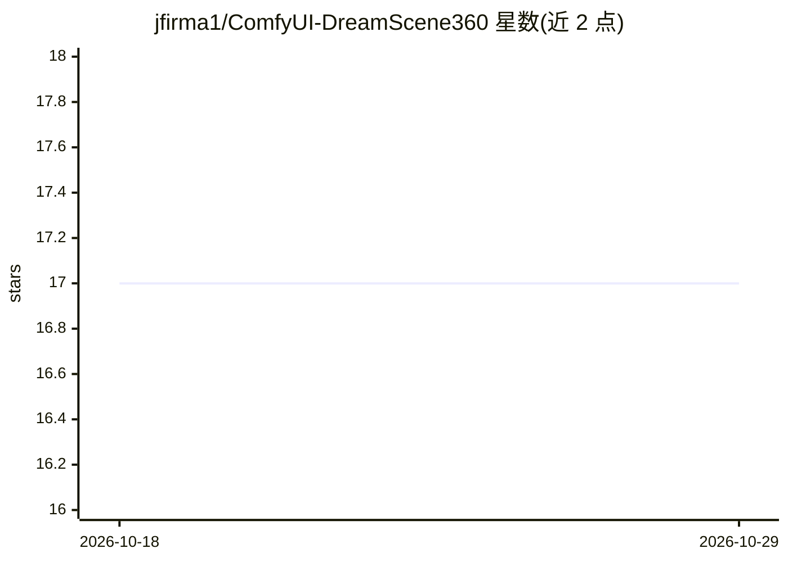

# jfirma1/ComfyUI-DreamScene360

⭐ 17 · Python · 推送 2026-07-23 · [GitHub](https://github.com/jfirma1/ComfyUI-DreamScene360) · 个人维护

**将 360° 全景图转为 3D Gaussian Splat 点云的 ComfyUI 节点**

ComfyUI 自定义节点，封装 DreamScene360（ECCV 2024）的全景转 3D 路径：输入一张 360° 等距柱状全景图与深度图，经切面投影、单目深度估计（omnidata_dpt_depth_v2）、全局深度对齐与 MLP 精修，再以 3D Gaussian Splatting 训练，输出标准 .ply 点云供下游 3D 节点使用。仅用全景转 3D 路径，不需要 OpenAI key 或扩散模型。需要 NVIDIA GPU（8GB+ VRAM）、CUDA toolkit 编译子模块，提供自动安装脚本与 RunPod 部署说明。

## 筛选速览

| 维度 | 判定 | 备注 |
|---|---|---|
| AI 角色 | `ai-native` | 本体是模型或模型工具 |
| 许可风险 | `none` | — |
| 部署形态 | `library` | 以包/库形式分发 |
| 模型依赖 | — | README 未给出锁定关系 |
| 硬件要求 | `gpu-8g` | |
| 安装摩擦 | `medium` | 含编译或系统依赖之一 |
| 成熟度 | — | 结构信号不足 |

## 能力要点

- 全景图 + 深度图 → 3DGS .ply 点云的完整管线
- 基于场景名的训练缓存，重跑同场景直接加载结果
- 提供 RunPod Docker 环境与依赖恢复脚本
- 附带 Load Gaussian PLY / Save Point Cloud 工具节点

## 适用场景

- 在 ComfyUI 工作流中把 360° 全景重建为 3D 场景点云
- 为下游 3D / inpainting 节点提供 Gaussian Splat 几何输入
- 用已有 .ply 文件跳过训练直接接入 3D 工作流

## 场景标签

`图像视频处理` · 领域:感知与多模态

## 证据(README 行号)

> L3: A ComfyUI custom node wrapping the **Panorama-to-3D** path of DreamScene360 (ECCV 2024). Feed it a 360° equirectangu
> L16: 2. **Monocular depth estimation** — run `omnidata_dpt_depth_v2` on each crop
> L20: 6. **Gaussian Splatting training** — initialize 3DGS from the point cloud and optimize against the original panoram

## 星数曲线

2026-10-18 17 → 2026-10-29 17（+0）

---
*卡片 v1 · prompt 1.4 · 生成 2026-10-29 · 置信度 mid · 依据 README sha `145d4d74a6a3` · [字段定义](../../DATASET.md)*
