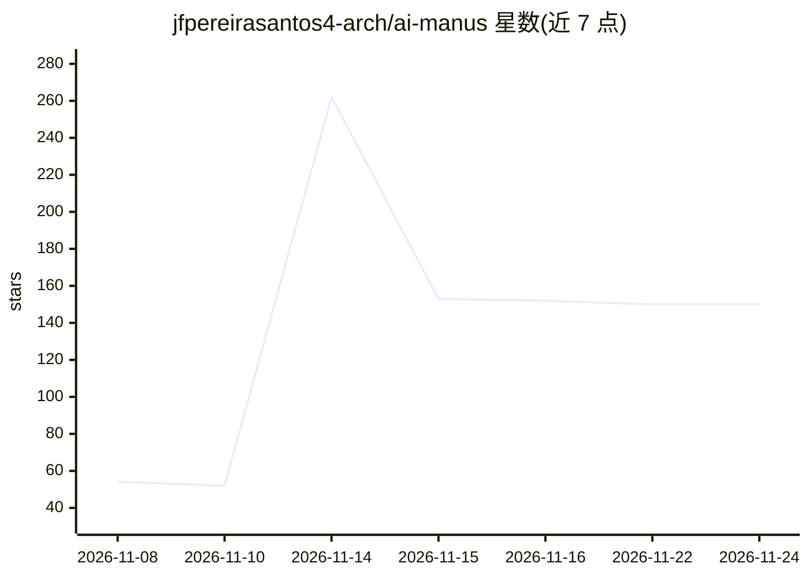

# jfpereirasantos4-arch/ai-manus

⭐ 150 · Python · Apache-2.0 · 推送 2026-11-15 · [GitHub](https://github.com/jfpereirasantos4-arch/ai-manus) · 个人维护

**自主执行代码与浏览器操作的通用 AI Agent 系统**

面向家庭、学习与轻量办公场景的自主 AI Agent：用户以自然语言描述需求，Agent 自行编写并执行脚本、打开网页、与页面元素交互、完成多步骤任务，代码执行与浏览器控制可在同一流程中衔接，需最少监督即可运行。定位为非开发者的轻量助手，不面向企业级平台场景。README 声明兼容 64 位现代系统（最低双核 CPU、4GB 内存），但未给出具体的安装命令、模型接入方式或代码运行细节，实际使用方式仅见『Download Manus』字样。

## 筛选速览

| 维度 | 判定 | 备注 |
|---|---|---|
| AI 角色 | `ai-native` | 本体是模型或模型工具 |
| 许可风险 | `permissive` | Apache-2.0 |
| 部署形态 | `None` |  |
| 模型依赖 | — | README 未给出锁定关系 |
| 硬件要求 | — | 无带数字的原话,不猜 |
| 安装摩擦 | `low` | 无编译、无系统依赖或容器化 |
| 成熟度 | — | 结构信号不足 |

## 能力要点

- 自主执行代码：Agent 自行编写并运行脚本完成任务
- 浏览器控制：导航网页、填写表单、采集信息
- 代码与浏览器动作在同一工作流中衔接
- 面向家庭、学习、轻量办公的小规模任务设计

## 适用场景

- 让 Agent 代为执行重复性的脚本与网页操作
- 学生整理研究笔记、运行快速计算
- 远程工作者从多页面收集数据并汇总

## 场景标签

`浏览器自动化` `编码 Agent` `AI 助手` · 领域:效率与自动化

## 证据(README 行号)

> L10: - **Autonomous Code Execution:** Manus AI agent runs code on its own to complete tasks, so you can focus on decisio
> L18: Manus is an autonomous AI agent designed to run code and control a browser on your behalf. Instead of acting like a

## 星数曲线

2026-11-08 54 → 2026-11-24 150（+96）

---
*卡片 v1 · prompt 1.4 · 生成 2026-11-17 · 置信度 mid · 依据 README sha `0b7364c4f502` · [字段定义](../../DATASET.md)*
