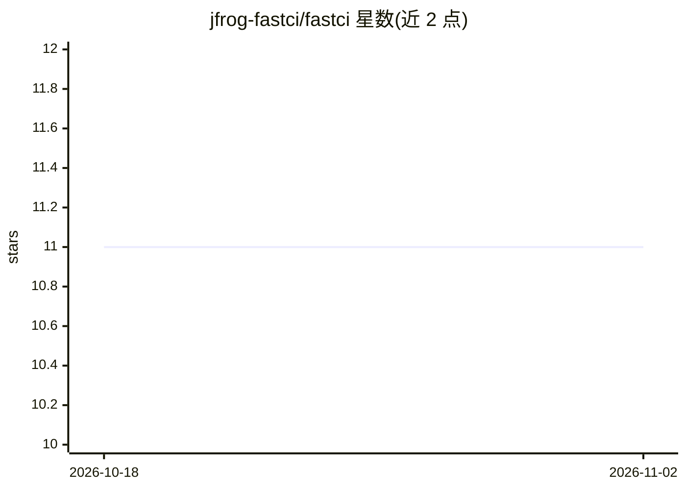

# jfrog-fastci/fastci

⭐ 11 · TypeScript · NOASSERTION · 推送 2026-07-08 · [GitHub](https://github.com/jfrog-fastci/fastci) · [官网](https://fastci.jfrog.com/) · 组织维护

**GitHub Actions 的 CI 瓶颈识别与自动修复 agent**

以 GitHub Action 步骤形式接入工作流的 CI 优化 agent：实时分析 CI 运行，识别性能瓶颈并以带 fastci-insight 标签或 [FastCI] 前缀的 GitHub Issue 形式标记问题；可选的 Agent 工作流在 Issue 出现时触发外部 AI agent（通过 CURSOR_API_KEY 接入 Cursor）实现修复并自动创建 PR，合并 PR 后自动关闭对应 Issue。要求 issues: write 权限，非 JFrog 组织需在 fastci.config.json 中接受 Beta 条款。目前处于 Beta 阶段。

## 筛选速览

| 维度 | 判定 | 备注 |
|---|---|---|
| AI 角色 | `ai-enhanced` | 去掉 AI 部分产品仍成立 |
| 许可风险 | `none` | NOASSERTION |
| 部署形态 | `None` |  |
| 模型依赖 | — | README 未给出锁定关系 |
| 硬件要求 | — | 无带数字的原话,不猜 |
| 安装摩擦 | `low` | 无编译、无系统依赖或容器化 |
| 成熟度 | `idea` | |

## 能力要点

- 作为 GitHub Action 步骤接入，实时分析 CI 运行并识别性能瓶颈
- 自动创建带 fastci-insight 标签的 GitHub Issue
- Agent 工作流触发 AI agent 实现修复并自动创建 PR，合并后自动关闭 Issue
- 支持容器作业的 volume 挂载配置

## 适用场景

- 持续监控 CI 流水线性能，防止技术债累积
- 让 AI agent 自动修复被标记的 CI 性能问题并提交 PR
- 把 CI 维护从被动响应转为主动监控

## 场景标签

`编码 Agent` · 领域:编码与开发

## 证据(README 行号)

> L104: 4. **An AI agent implements the fix** and creates a pull request
> L84: |`CURSOR_API_KEY`|API key for the Cursor AI agent|

## 星数曲线

2026-10-18 11 → 2026-11-02 11（+0）

---
*卡片 v1 · prompt 1.4 · 生成 2026-11-02 · 置信度 mid · 依据 README sha `0cbcbc285b70` · [字段定义](../../DATASET.md)*
