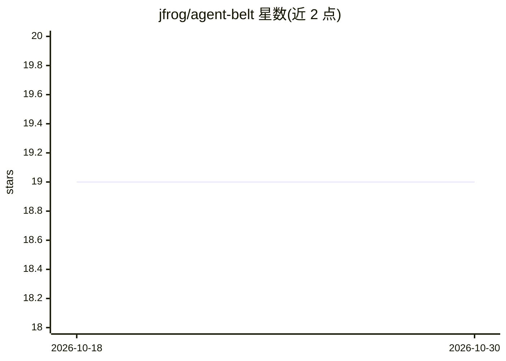

# jfrog/agent-belt

⭐ 19 · Python · Apache-2.0 · 推送 2026-10-07 · [GitHub](https://github.com/jfrog/agent-belt) · 组织维护

**AI 编程 agent CLI 的可复现多轮场景评测工具**

以用户实际安装的 agent CLI（Claude Code、Codex、Cursor、Copilot、Gemini CLI、Goose、OpenCode 或自定义 agent）为评测单元的黑盒评测框架：以子进程方式驱动 agent 在真实工作区中跑多轮场景，用规则检查、工作区 diff 和独立 LLM judge 评分；通过重复试验的 pass^k、改写场景族与多 judge 共识来度量方差。场景以 JSON 组目录形式编写，提供 pip 安装与 belt 命令行，支持 CI 集成与插件扩展。需 Python 3.11+ 且至少安装并认证一个 agent CLI；不评测 LLM 本身、不替代 agent 循环。

## 筛选速览

| 维度 | 判定 | 备注 |
|---|---|---|
| AI 角色 | `ai-ecosystem` | LLM/agent 周边工具 |
| 许可风险 | `permissive` | Apache-2.0 |
| 部署形态 | `library` | 以包/库形式分发 |
| 模型依赖 | local-ok | 支持本地模型 |
| 硬件要求 | — | 无带数字的原话,不猜 |
| 安装摩擦 | `low` | 无编译、无系统依赖或容器化 |
| 成熟度 | — | 结构信号不足 |

## 能力要点

- 以黑盒 agent CLI 为评测单元，同一 harness 驱动任意 CLI agent
- 规则检查 + workspace diff + 独立 LLM judge 的多机制评分
- pass^k 重复试验、改写场景族与多 judge 共识度量方差
- 场景随 wheel 打包，pip 安装后无需克隆源码即可运行

## 适用场景

- 团队对实际交付给用户的 agent CLI 做回归评测
- 在自己的仓库上用自定义场景对比多个编码 agent 的表现
- CI 中以阈值门禁验证 agent 行为是否达标

## 场景标签

`模型评测` · 领域:评测与运维

## 证据(README 行号)

> L3: A seat belt for the agents you ship. Run reproducible multi-turn scenarios
> L93: 1. **The black-box CLI is the unit.** Not the model. Not a wrapper. Not

## 星数曲线

2026-10-18 19 → 2026-10-30 19（+0）

---
*卡片 v1 · prompt 1.4 · 生成 2026-10-28 · 置信度 mid · 依据 README sha `3182bcd35dff` · [字段定义](../../DATASET.md)*
