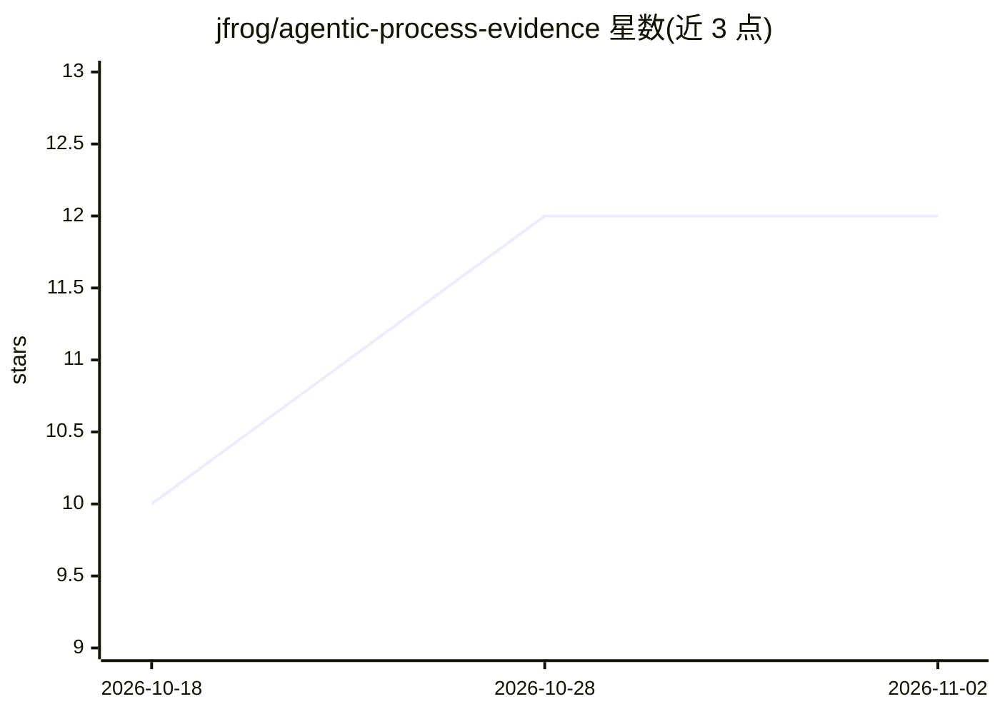

# jfrog/agentic-process-evidence

⭐ 12 · Apache-2.0 · 推送 2026-10-12 · [GitHub](https://github.com/jfrog/agentic-process-evidence) · 组织维护

**将 AI agent 会话证据绑定到 SDLC 实体的治理标准**

JFrog 维护的提案性标准，定义如何将 agent 会话信息（会话日志、provider 栈、工具、结果、owner、审查者）以 in-toto 风格的 provenance 证据绑定到 git commit、artifact、应用版本等 SDLC 实体，使组织能对 AI 辅助开发做溯源、策略校验、人类监督与合规留存（如 EU AI Act 6 个月日志保留）。模型含三部分：会话日志（BOM）、agentic process 证据、Agent runtime 工具。实体定义置于 spec/，README 未给出具体安装命令。

## 筛选速览

| 维度 | 判定 | 备注 |
|---|---|---|
| AI 角色 | `ai-ecosystem` | LLM/agent 周边工具 |
| 许可风险 | `permissive` | Apache-2.0 |
| 部署形态 | `None` |  |
| 模型依赖 | — | README 未给出锁定关系 |
| 硬件要求 | — | 无带数字的原话,不猜 |
| 安装摩擦 | `low` | 无编译、无系统依赖或容器化 |
| 成熟度 | `idea` | |

## 能力要点

- in-toto 风格证据将 agent 会话绑定到 commit/artifact/release 等 SDLC 实体
- Session 与 Process 双层模型：单次 agent 运行 vs 组织问责的结果单元
- 支持策略即代码校验（允许名单模型、人类审查、命名 owner）与对齐检查
- 引用 Testigo 作为集成，提供 DSSE 签名会话日志

## 适用场景

- 追溯某次 commit 或发布由哪些 agent 会话、模型与工具参与
- 在发布流水线中拦截未过允许名单模型或缺少人类审查的变更
- 按法规要求（如 EU AI Act）留存 agent 过程日志并关联开发过程

## 场景标签

 · 领域:软件开发治理/供应链安全

## 证据(README 行号)

> L6: This repository defines how to bind agent session information to SDLC entities (commits, artifacts, application vers
> L12: Agentic tools (IDE agents, review bots, release assistants) change code and influence releases, but their provenanc
> L39: By attaching **in-toto-style evidence** to git commits, artifacts and application releases, agentic activity become

## 星数曲线

2026-10-18 10 → 2026-11-02 12（+2）

---
*卡片 v1 · prompt 1.4 · 生成 2026-11-01 · 置信度 high · 依据 README sha `270615d93e81` · [字段定义](../../DATASET.md)*
