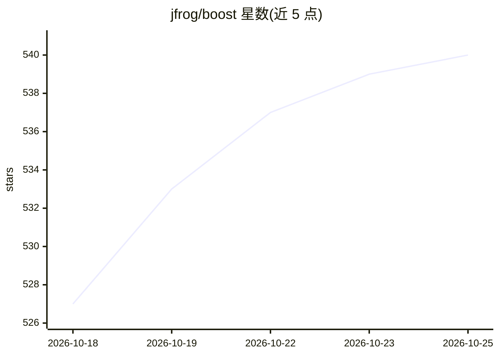

# jfrog/boost

⭐ 540 · Shell · NOASSERTION · 推送 2026-10-25 · [GitHub](https://github.com/jfrog/boost) · [官网](https://boost.jfrog.com/) · 组织维护

**给编码 agent 瘦身上下文的本地 CLI/桌面工具，减少 token 消耗**

JFrog 出品的本地优先工具，置于编码 agent（Claude Code、Cursor、Codex CLI、GitHub Copilot、OpenCode）与其读取的输出之间：对 100+ 工具的终端输出、MCP JSON 响应、读取的文件做压缩过滤，保留错误与摘要，全部原始输出可逆保存在本机并可随时取回。提供节省看板、PR 用量评论（分阶段推出）、OpenTelemetry 导出与 BoostGraph 代码图查询（早期访问）。以桌面应用（macOS/Windows）与 CLI（macOS/Linux/WSL/Windows/CI）两种方式安装，处于 preview 阶段。

## 筛选速览

| 维度 | 判定 | 备注 |
|---|---|---|
| AI 角色 | `ai-ecosystem` | LLM/agent 周边工具 |
| 许可风险 | `none` | NOASSERTION |
| 部署形态 | `None` |  |
| 模型依赖 | — | README 未给出锁定关系 |
| 硬件要求 | — | 无带数字的原话,不猜 |
| 安装摩擦 | `low` | 无编译、无系统依赖或容器化 |
| 成熟度 | `idea` | |

## 能力要点

- 100+ 工具的内置终端过滤器，保留失败/错误/摘要，丢弃横幅与进度条
- 可逆输出：原始输出本机保存，可随时 boost retrieve 取回
- 文件优化：pdf/ipynb/图片转为更轻量版本供 agent 读取
- OpenTelemetry 导出与节省看板

## 适用场景

- 让编码 agent 在长会话中少消耗上下文 token
- 在 CI 中给 agent 任务瘦身输出
- 查看每个 PR / 每个会话的 token 花费

## 场景标签

`LLM 可观测性` · 领域:评测与运维

## 证据(README 行号)

> L9:  Boost trims the noisy output your coding agents read (test runs, builds, logs, diffs, MCP responses)
> L92: Your agent works exactly as before. Boost sits between the agent and everything it reads, and it runs entirely on y

## 星数曲线

2026-10-18 527 → 2026-10-25 540（+13）

---
*卡片 v1 · prompt 1.4 · 生成 2026-10-21 · 置信度 high · 依据 README sha `7d48f66d17b3` · [字段定义](../../DATASET.md)*
