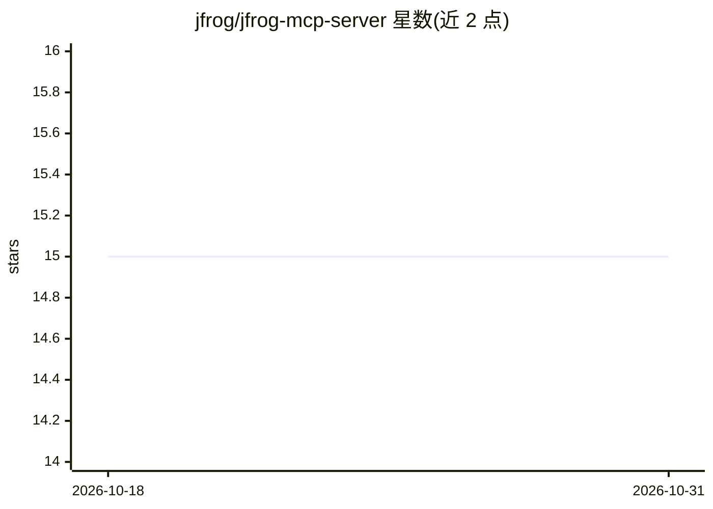

# jfrog/jfrog-mcp-server

⭐ 15 · 推送 2026-10-18 · [GitHub](https://github.com/jfrog/jfrog-mcp-server) · 组织维护

**JFrog 平台的 MCP 服务器：让 AI 助手访问制品库与安全数据**

JFrog 官方的 Model Context Protocol 服务器，将 JFrog 平台能力接入 IDE 与 AI 编码助手（VS Code、Cursor、Claude、Kiro、Codex），以自然语言查询制品与安全信息。提供资源管理、制品与构建发现（AQL 检索）、目录与 curation 状态查询、Xray 安全摘要与 CVE 影响追踪等功能，共 100+ 工具。云端版 GA，自托管版 Beta（Helm/Docker Compose 部署），通过 OAuth 认证，无需客户端安装升级。

## 筛选速览

| 维度 | 判定 | 备注 |
|---|---|---|
| AI 角色 | `ai-ecosystem` | LLM/agent 周边工具 |
| 许可风险 | `none` | — |
| 部署形态 | `self-host` | docker 或自建部署 |
| 模型依赖 | — | README 未给出锁定关系 |
| 硬件要求 | — | 无带数字的原话,不猜 |
| 安装摩擦 | `low` | 无编译、无系统依赖或容器化 |
| 成熟度 | `idea` | |

## 能力要点

- 暴露 100+ 工具，覆盖 Artifactory、Xray 安全、Curation、AI Catalog 等
- 托管于 JFrog Cloud，客户端无需安装或升级，OAuth 认证免管理 API key
- 自然语言查询包版本、漏洞、curation 状态与 CVE 影响链
- 自托管版本支持 Helm 与 Docker Compose 部署（Beta）

## 适用场景

- 在 IDE 中用自然语言查询制品、构建与安全漏洞信息
- 编码时确保只使用经过审批的依赖包
- 追踪某个 CVE 或包影响的全部资源
- 管理 JFrog 项目、仓库与制品

## 场景标签

 · 领域:开发工具/DevOps 基础设施

## 证据(README 行号)

> L7: **JFrog MCP Server empowers developers, bringing the advanced capabilities of the JFrog platform to the development 
> L72: The server exposes over 100 tools across Access, Artifactory, Security, Curation, Distribution, AI Catalog, Grid, W

## 星数曲线

2026-10-18 15 → 2026-10-31 15（+0）

---
*卡片 v1 · prompt 1.4 · 生成 2026-10-30 · 置信度 mid · 依据 README sha `7c9a71f0a0f9` · [字段定义](../../DATASET.md)*
