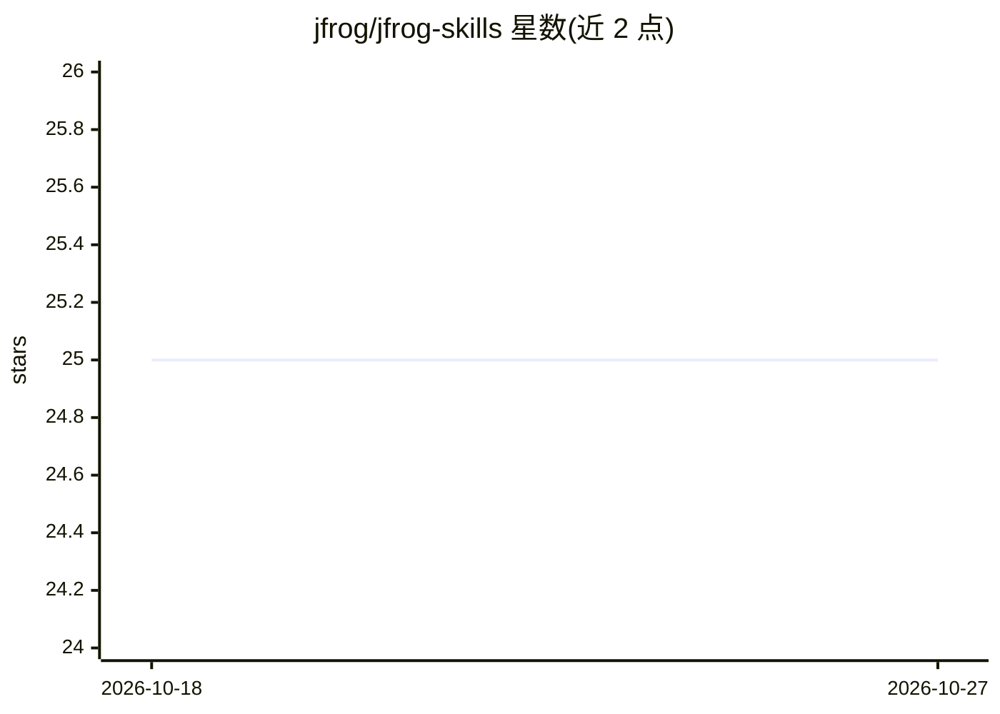

# jfrog/jfrog-skills

⭐ 25 · JavaScript · Apache-2.0 · 推送 2026-10-21 · [GitHub](https://github.com/jfrog/jfrog-skills) · 组织维护

**JFrog 平台的 AI agent 技能包：用自然语言操作制品库**

JFrog 官方维护的一组 AI coding agent 技能：基础技能 `jfrog` 覆盖 CLI 设置、制品操作、安全查询、AQL 与 GraphQL；另有包安全治理、AI Catalog 技能发现与发布、参考架构规划、本地包管理器绑定等工作流技能。安装在 AI 编程 agent 中后，通过 `jf` CLI 或 REST/GraphQL API 与 JFrog 实例交互，支持制品搜索下载、CVE 查询、合规审计、构建溯源、存储清理等自然语言操作。要求 `jf` CLI ≥ 2.100.0、curl、jq，处于 beta 阶段。

## 筛选速览

| 维度 | 判定 | 备注 |
|---|---|---|
| AI 角色 | `ai-ecosystem` | LLM/agent 周边工具 |
| 许可风险 | `permissive` | Apache-2.0 |
| 部署形态 | `library` | 以包/库形式分发 |
| 模型依赖 | — | README 未给出锁定关系 |
| 硬件要求 | — | 无带数字的原话,不猜 |
| 安装摩擦 | `low` | 无编译、无系统依赖或容器化 |
| 成熟度 | `idea` | |

## 能力要点

- 基础技能 `jfrog` 覆盖制品操作、安全查询、AQL 与 GraphQL
- 包治理/合规工作流可排查 Curation 拦截导致的安装失败
- 构建溯源与 checksum 校验：定位制品由哪个构建产出
- AI Catalog 技能的发现、安装、更新与发布

## 适用场景

- 通过自然语言搜索与下载 Artifactory 中的制品
- 查询包的 CVE、curation 状态与许可证风险
- 排查 npm install 失败是否由 Curation 拦截引起
- 用 `jf setup` 将本地包管理器绑定到 Artifactory

## 场景标签

`网络安全` · 领域:学习与行业

## 证据(README 行号)

> L5: This repository ships AI agent skills for the JFrog Platform:
> L13: Install them in your AI coding agent and interact with JFrog through natural language. The `jfrog` skill must alway
> L247: When your agent receives a JFrog-related request, it reads the skill and matches the task to the appropriate refer

## 星数曲线

2026-10-18 25 → 2026-10-27 25（+0）

---
*卡片 v1 · prompt 1.4 · 生成 2026-10-27 · 置信度 high · 依据 README sha `05835cbf2040` · [字段定义](../../DATASET.md)*
