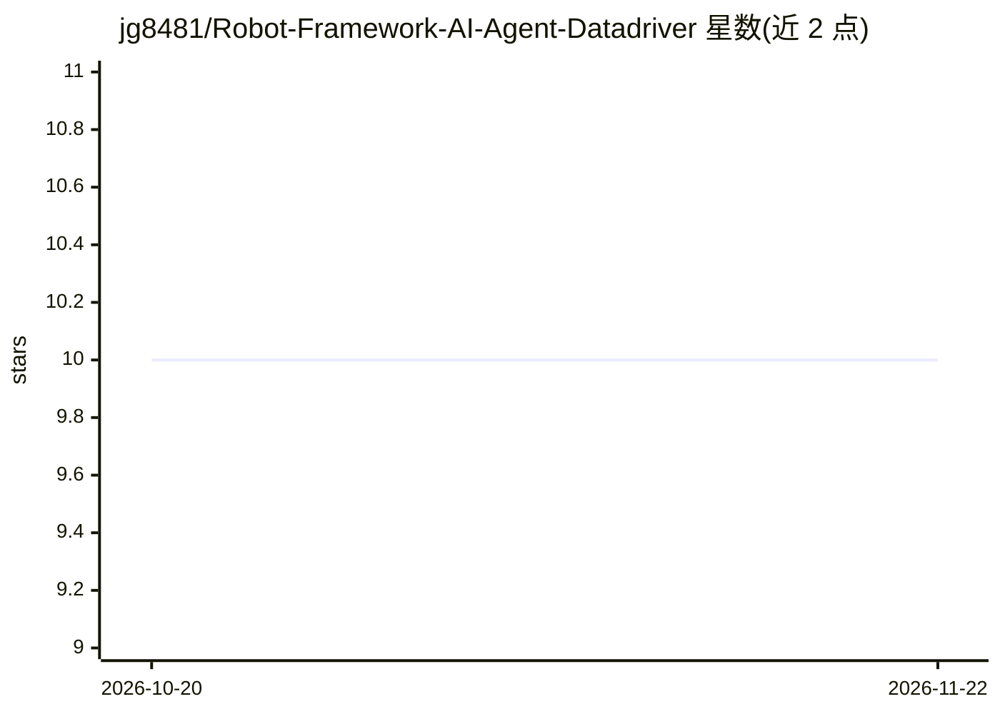

# jg8481/Robot-Framework-AI-Agent-Datadriver

⭐ 10 · HTML · 推送 2026-01-18 · [GitHub](https://github.com/jg8481/Robot-Framework-AI-Agent-Datadriver) · 个人维护

**面向 RPA 从业者的 AI agent 实验工具集**

基于 Robot Framework 生态的实验性工具集，将 Codename Goose、MCP 工具与既有 RPA 流程结合：用 robotframework-datadriver 与 tags 控制不同类别的 agent 提示词，用 Pabot 并行运行多个 Codename Goose Docker 容器。提供两种运行路径：本地 Ollama 去中心化模型，或需 API key 的云端提供商加 Docker 容器。附带研究问答、RAG 数据分析等示例工作流，通过 shell 脚本启动。

## 筛选速览

| 维度 | 判定 | 备注 |
|---|---|---|
| AI 角色 | `ai-ecosystem` | LLM/agent 周边工具 |
| 许可风险 | `none` | — |
| 部署形态 | `None` |  |
| 模型依赖 | local-ok | 支持本地模型 |
| 硬件要求 | — | 无带数字的原话,不猜 |
| 安装摩擦 | `low` | 无编译、无系统依赖或容器化 |
| 成熟度 | `idea` | |

## 能力要点

- 用 robotframework-datadriver 与 tags 管理 agent 提示词类别
- Pabot 并行运行多个 Codename Goose Docker 容器
- 支持本地 Ollama 模型（示例为 qwen2.5:14b）或云端 API 两种路径
- 提供 RAG 分析文本数据集的示例工作流（限 Docker agent）

## 适用场景

- 为任意主题运行 AI agent 研究助手工作流
- 用 RAG 让 agent 分析源码、日志、报告等文本数据集
- 在 Robot Framework RPA 流程中接入 LLM agent 与 MCP 工具

## 场景标签

`RAG` `Agent 框架` · 领域:Agent 开发

## 证据(README 行号)

> L7: This experimental toolkit is intended to help explore new technologies related to LLMs, AI agents, and MCP tools com
> L45: - **Codename Goose**, a framework for creating AI agents.
> L9: I've taken some inspiration from the Codename Goose approach to using instruction files to automate AI agents. Inste

## 星数曲线

2026-10-20 10 → 2026-11-22 10（+0）

---
*卡片 v1 · prompt 1.4 · 生成 2026-11-19 · 置信度 high · 依据 README sha `dffb18b4440c` · [字段定义](../../DATASET.md)*
