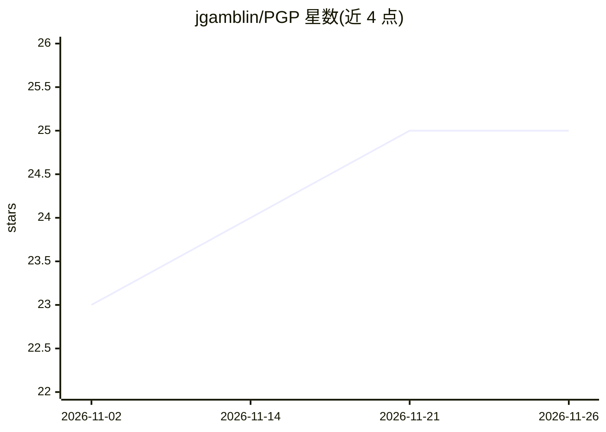

# jgamblin/PGP

⭐ 25 · Python · GPL-3.0 · 推送 2026-03-04 · [GitHub](https://github.com/jgamblin/PGP) · 个人维护

**个人 AI 编码助手提示词库：96 条工程实践提示词**

由 @JGamblin 维护的个人提示词与技能合集，面向 AI 编码助手使用场景：96 个提示词按 ai/db/frontend/generic/html/infrastructure/python/ruby 八个目录组织，覆盖 LLM 集成、数据库、前端、Kubernetes、Python/Ruby 等。含 2 个原生 SKILL.md 技能（Codex 与 ClaudeAI 路径），提供领域级 agents.md 路由入口、提示词元数据规范与文档 QA 脚本。明确声明为个人项目，不接受 PR，仅支持 fork 自行适配；html/ 目录为向后兼容保留。

## 筛选速览

| 维度 | 判定 | 备注 |
|---|---|---|
| AI 角色 | `ai-knowledge` | 知识聚合/清单类 |
| 许可风险 | `viral` | GPL-3.0 |
| 部署形态 | `None` |  |
| 模型依赖 | — | README 未给出锁定关系 |
| 硬件要求 | — | 无带数字的原话,不猜 |
| 安装摩擦 | `low` | 无编译、无系统依赖或容器化 |
| 成熟度 | — | 结构信号不足 |

## 能力要点

- 96 个提示词按 8 个工程领域目录组织
- 2 个原生 SKILL.md 技能（codex-pgp / claudeai-pgp）
- 各领域 agents.md 作为路由入口
- 提供文档 QA 脚本与统一元数据规范

## 适用场景

- 为 AI 编码助手查找特定语言的工程提示词
- 通过 agents.md 路由到合适的领域提示词
- fork 后改编为自己的提示词工作流

## 场景标签

`提示工程` `精选清单` · 领域:Agent 开发

## 证据(README 行号)

> L3: ## Personal AI Coding Assistant Prompt Library
> L16: |Directory|Prompt Count|Focus|

## 星数曲线

2026-11-02 23 → 2026-11-26 25（+2）

---
*卡片 v1 · prompt 1.4 · 生成 2026-11-18 · 置信度 high · 依据 README sha `90c8d3b369ee` · [字段定义](../../DATASET.md)*
