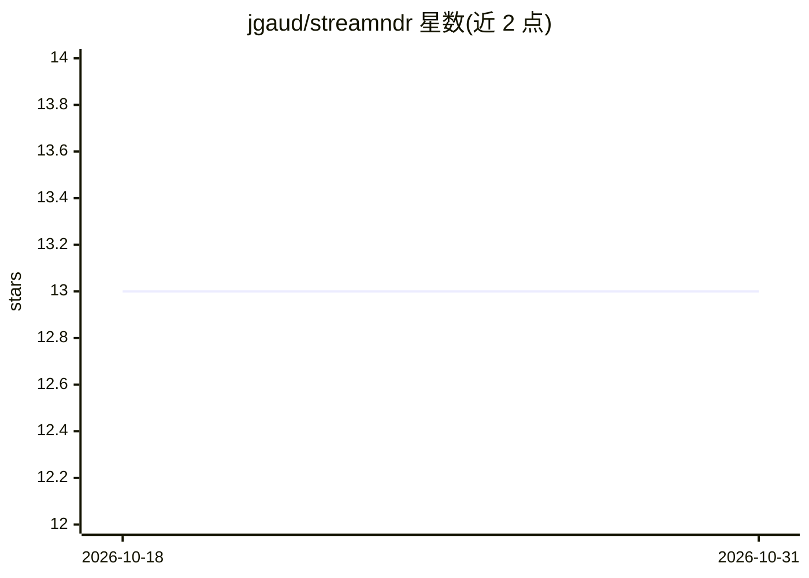

# jgaud/streamndr

⭐ 13 · Python · BSD-3-Clause · 推送 2026-03-01 · [GitHub](https://github.com/jgaud/streamndr) · [官网](https://jgaud.github.io/streamndr/) · 个人维护

**数据流在线新类检测的 Python 库（基于 river）**

StreamNDR 是面向数据流在线新颖性检测的 Python 库，遵循 river 的实现与格式，提供 MINAS、ECSMiner、ECSMiner-WF、ECHO 四种文献算法。模型先在已知类上离线训练（learn_many），再在线（predict_one）检测新类模式并自动更新无监督聚类；附带混淆矩阵及 MNew/FNew/ErrRate 等流式指标。需要 Python 3.6+，依赖 ClusOpt-Core（需 C/C++ 编译器与 Boost.Thread）；README 自述处于早期开发阶段，欢迎贡献者。

## 筛选速览

| 维度 | 判定 | 备注 |
|---|---|---|
| AI 角色 | `ai-native` | 本体是模型或模型工具 |
| 许可风险 | `permissive` | BSD-3-Clause |
| 部署形态 | `library` | 以包/库形式分发 |
| 模型依赖 | — | README 未给出锁定关系 |
| 硬件要求 | — | 无带数字的原话,不猜 |
| 安装摩擦 | `low` | 无编译、无系统依赖或容器化 |
| 成熟度 | `idea` | |

## 能力要点

- 实现 MINAS/ECSMiner/ECSMiner-WF/ECHO 四种数据流新类检测算法
- 遵循 river API，支持 learn_many/predict_one 在线学习与预测
- 提供 MNew/FNew/ErrRate 等流式新颖性检测指标

## 适用场景

- 在持续到达的数据流中检测训练时未见过的新类别
- 对流式分类任务做新类检测性能评估
- 在 river 生态中做增量学习研究

## 场景标签

 · 领域:机器学习/数据流挖掘

## 证据(README 行号)

> L14:  Stream Novelty Detection for River (StreamNDR) is a Python library for online novelty detection.
> L19: StreamNDR implements in Python various algorithms for novelty detection that have been proposed in the literature. 
> L41: As a quick example, we'll train three models (MINAS, ECSMiner-WF, and ECHO) to classify a synthetic dataset created

## 星数曲线

2026-10-18 13 → 2026-10-31 13（+0）

---
*卡片 v1 · prompt 1.4 · 生成 2026-10-31 · 置信度 high · 依据 README sha `5d39d7dd66b2` · [字段定义](../../DATASET.md)*
