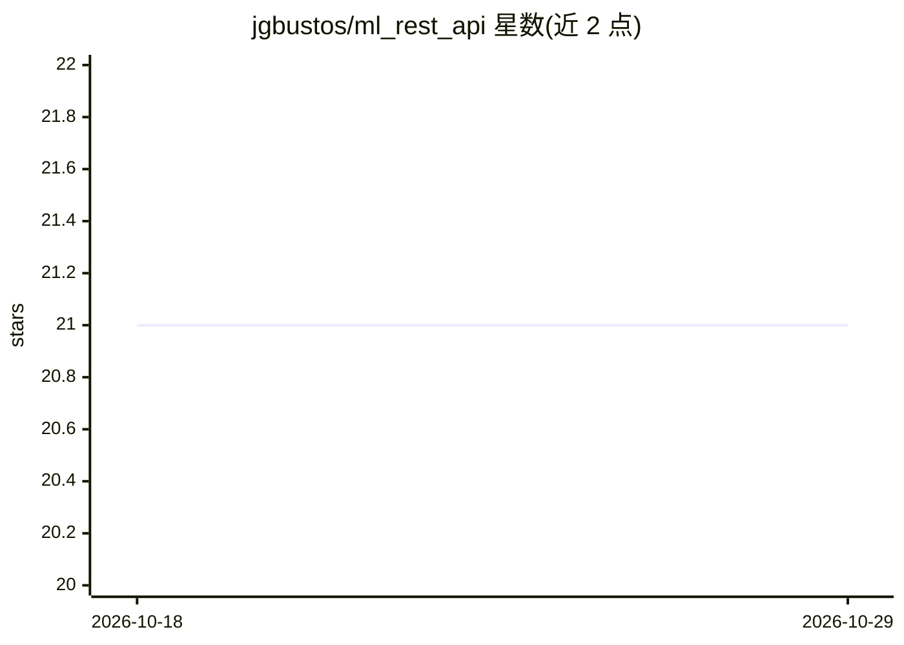

# jgbustos/ml_rest_api

⭐ 21 · Python · MIT · 推送 2026-02-27 · [GitHub](https://github.com/jgbustos/ml_rest_api) · 个人维护

**将已训练 ML 模型封装为 REST API 的 Flask-RESTX 服务模板**

基于 Python 3 与 Flask-RESTX 的 RESTful API 骨架，用于加载并调用已训练的机器学习模型返回预测。提供 Swagger 文档、liveness/readiness 健康探测端点（面向 Kubernetes 部署）、JSON 输入校验与配置化参数（环境变量覆盖 settings.py）。模型以 Python 模块形式放入 ml_trained_model 目录并实现初始化与预测接口。通过 GitHub Actions 构建容器镜像发布到 Docker Hub，也可经 pip -e . 从源码运行。

## 筛选速览

| 维度 | 判定 | 备注 |
|---|---|---|
| AI 角色 | `ai-ecosystem` | LLM/agent 周边工具 |
| 许可风险 | `permissive` | MIT |
| 部署形态 | `self-host` | docker 或自建部署 |
| 模型依赖 | — | README 未给出锁定关系 |
| 硬件要求 | — | 无带数字的原话,不猜 |
| 安装摩擦 | `low` | 无编译、无系统依赖或容器化 |
| 成熟度 | — | 结构信号不足 |

## 能力要点

- POST /api/model/predict 端点返回模型预测并做参数校验
- liveness/readiness 探测端点面向 Kubernetes 部署
- 自动生成 Swagger 文档（JSON 与 UI）
- GitHub Actions 构建镜像并发布至 Docker Hub

## 适用场景

- 把训练好的模型快速暴露为带文档的预测 API
- 在 Kubernetes 中以健康探测方式部署模型服务
- 以 Docker 容器方式运行模型推理服务

## 场景标签

`推理引擎` · 领域:训练与推理

## 证据(README 行号)

> L8: A RESTful API to return predictions from a trained ML model, built with Python 3 and Flask-RESTX
> L55: * POST <http://localhost:8888/api/model/predict> will return a prediction using the ML model. The data_point struct
> L91: ## Build automation

## 星数曲线

2026-10-18 21 → 2026-10-29 21（+0）

---
*卡片 v1 · prompt 1.4 · 生成 2026-10-28 · 置信度 high · 依据 README sha `43f835266392` · [字段定义](../../DATASET.md)*
