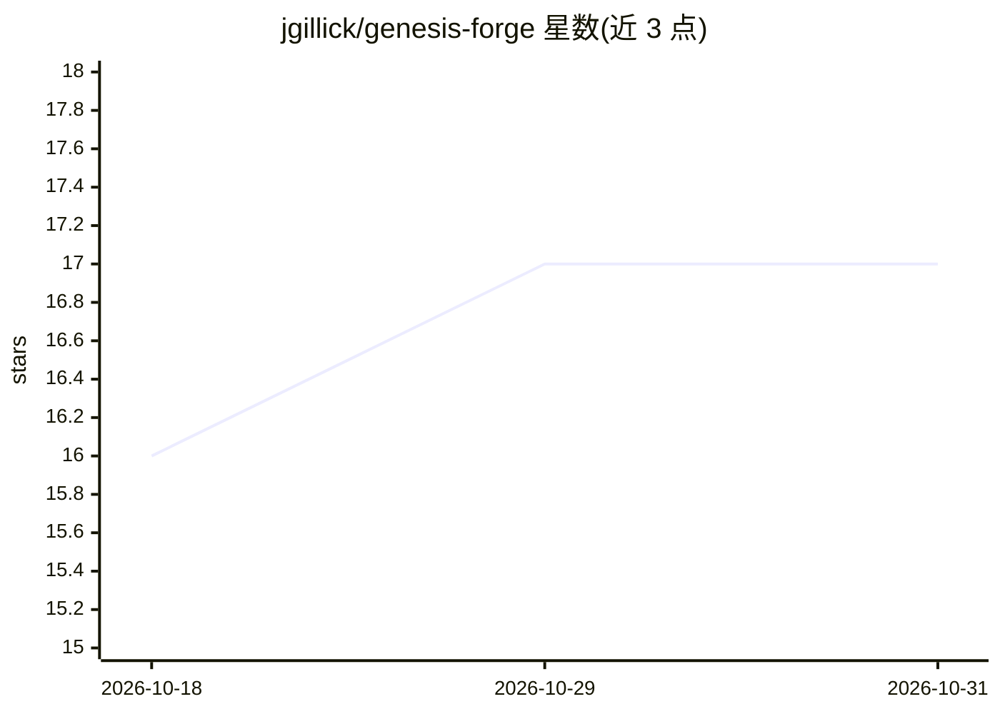

# jgillick/genesis-forge

⭐ 17 · Python · Apache-2.0 · 推送 2026-10-28 · [GitHub](https://github.com/jgillick/genesis-forge) · [官网](https://genesisforge.io) · 个人维护

**机器人强化学习训练框架，基于 Genesis 物理仿真**

基于 Genesis 物理仿真器构建的模块化机器人强化学习框架，受 Isaac Lab 与 Gymnasiium 启发，提供 managers、MDP 函数、环境与部署导出器，训练依赖 Genesis 与 torch。仓库同时发布第二个包 genesis-forge-runtime，仅在机器人端用 numpy 重放训练好的观测与动作管线，无需仿真器与 torch。支持大规模并行运动训练、手柄控制接口、复杂地形与避障，并附连接真机的部署路径。

## 筛选速览

| 维度 | 判定 | 备注 |
|---|---|---|
| AI 角色 | `ai-native` | 本体是模型或模型工具 |
| 许可风险 | `permissive` | Apache-2.0 |
| 部署形态 | `library` | 以包/库形式分发 |
| 模型依赖 | — | README 未给出锁定关系 |
| 硬件要求 | — | 无带数字的原话,不猜 |
| 安装摩擦 | `low` | 无编译、无系统依赖或容器化 |
| 成熟度 | — | 结构信号不足 |

## 能力要点

- managers/MDP 函数/环境与部署导出器组成的框架结构
- genesis-forge-runtime 仅用 numpy 在机器人端重放策略管线
- 大规模并行运动训练与手柄控制接口

## 适用场景

- 在 Genesis 仿真中训练机器人运动与避障策略
- 将训练好的策略导出并部署到实体机器人
- 用统一框架管理强化学习环境与 MDP 组件

## 场景标签

`强化学习` · 领域:训练与推理

## 证据(README 行号)

> L3: A powerful and easy to use robotics reinforcement learning framework built on the Genesis physics simulator, plus th
> L21: |**genesis-forge**|your training machine|The framework: managers, MDP functions, environments, and the deployment e

## 星数曲线

2026-10-18 16 → 2026-10-31 17（+1）

---
*卡片 v1 · prompt 1.4 · 生成 2026-10-29 · 置信度 high · 依据 README sha `6010a13faecd` · [字段定义](../../DATASET.md)*
