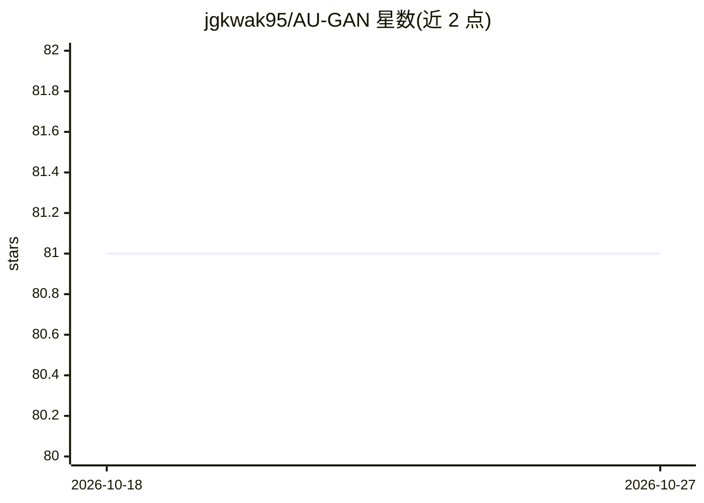

# jgkwak95/AU-GAN

⭐ 81 · Python · 推送 2026-07-28 · [GitHub](https://github.com/jgkwak95/AU-GAN) · 个人维护

**恶劣天气图像翻译 GAN 的官方 TensorFlow 实现（BMVC2021）**

论文 "Adverse Weather Image Translation with Asymmetric and Uncertainty-aware GAN"（BMVC 2021）的官方 TensorFlow 实现，提供夜间→白天、雨夜→白天的图像到图像翻译。生成器采用非对称结构处理 day→night 与 night→day 编辑，并输出不确定性图。支持 BDD100K 与 Alderley 数据集的训练与测试，提供 BDD100K 预训练模型下载。以源码仓库形式发布，面向复现实验的科研用户。

## 筛选速览

| 维度 | 判定 | 备注 |
|---|---|---|
| AI 角色 | `ai-native` | 本体是模型或模型工具 |
| 许可风险 | `none` | — |
| 部署形态 | `None` |  |
| 模型依赖 | — | README 未给出锁定关系 |
| 硬件要求 | — | 无带数字的原话,不猜 |
| 安装摩擦 | `low` | 无编译、无系统依赖或容器化 |
| 成熟度 | — | 结构信号不足 |

## 能力要点

- 非对称结构生成器，支持 day→night 与 night→day 双向翻译
- 提供不确定性图输出
- 支持 BDD100K 与 Alderley 数据集的训练与测试
- 提供 BDD100K 预训练模型下载

## 适用场景

- 复现 BMVC2021 论文的实验结果
- 在 BDD100K/Alderley 数据集上训练恶劣天气图像翻译模型
- 使用预训练模型生成夜间→白天的翻译图像

## 场景标签

`科研工具` `图像生成` · 领域:内容生成

## 证据(README 行号)

> L1: # Adverse Weather Image Translation with Asymmetric and Uncertainty-aware GAN (AU-GAN)
> L2: Official Tensorflow implementation of Adverse Weather Image Translation with Asymmetric and Uncertainty-aware GAN (A
> L14: Our generator has asymmetric structure for editing day&rarr;night and night&rarr;day.

## 星数曲线

2026-10-18 81 → 2026-10-27 81（+0）

---
*卡片 v1 · prompt 1.4 · 生成 2026-10-24 · 置信度 high · 依据 README sha `4bceb7275e6b` · [字段定义](../../DATASET.md)*
