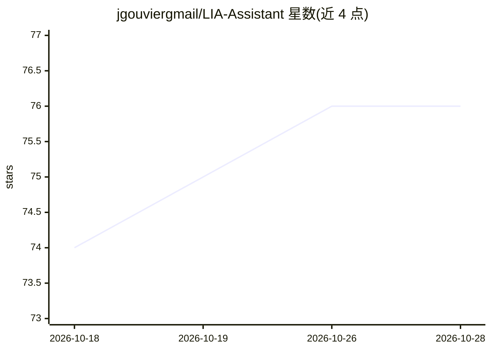

# jgouviergmail/LIA-Assistant

⭐ 78 · Python · AGPL-3.0 · 推送 2026-10-28 · [GitHub](https://github.com/jgouviergmail/LIA-Assistant) · [官网](https://lia.jeyswork.com/) · 个人维护

**可自托管的多用户个人 AI 助手 Web 应用**

开源且可自托管的个人 AI 助手 Web 应用：把邮件、日历、文档、偏好与承诺等个人上下文连接起来，支持会话准备、日程组织、每日简报、个人 Radio、提醒、例程与主动建议。技术栈为 Python/FastAPI + Next.js，采用 LangGraph/LangChain 编排多 agent，含 Human-in-the-Loop 审批流、记忆库、会议记录、Relations 关系视图与 Grafana 可观测性。云端模型与经 Ollama 服务的本地模型均可配置，提供六语言界面与多账户隔离。在线演示为闭源测试（受邀制），自建需按指南部署。

## 筛选速览

| 维度 | 判定 | 备注 |
|---|---|---|
| AI 角色 | `ai-native` | 本体是模型或模型工具 |
| 许可风险 | `viral` | AGPL-3.0 |
| 部署形态 | `self-host` | docker 或自建部署 |
| 模型依赖 | local-ok | 支持本地模型 |
| 硬件要求 | — | 无带数字的原话,不猜 |
| 安装摩擦 | `low` | 无编译、无系统依赖或容器化 |
| 成熟度 | — | 结构信号不足 |

## 能力要点

- LangGraph 编排的多 agent，Pipeline 与 ReAct 两种工作模式
- 审批流（Human-in-the-Loop）与可审计的操作登记册
- 多用户隔离账户、Grafana 仪表盘与告警规则
- 记忆/知识空间/会议记录/Relations 跨功能上下文复用

## 适用场景

- 自托管一个整合邮件、日历与文档的个人 AI 助手
- 在组织内部构建带审批与可观测性的公司助手
- 通过本地 Ollama 模型自托管以控制数据流向

## 场景标签

`AI 助手` `RAG` · 领域:对话与助手

## 证据(README 行号)

> L40: LIA is an open-source personal AI assistant in a web application you can host yourself. It connects the information
> L72: Cloud models and compatible local models served through native Ollama can be configured for supported processing ro

## 星数曲线

2026-10-18 74 → 2026-10-28 76（+2）

---
*卡片 v1 · prompt 1.4 · 生成 2026-10-24 · 置信度 high · 依据 README sha `522b00a9c1e5` · [字段定义](../../DATASET.md)*
