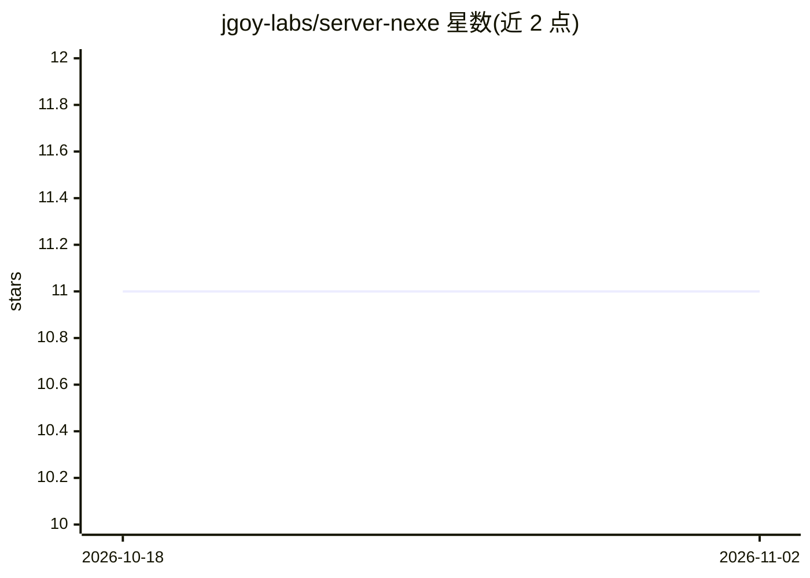

# jgoy-labs/server-nexe

⭐ 11 · Python · Apache-2.0 · 推送 2026-11-01 · [GitHub](https://github.com/jgoy-labs/server-nexe) · [官网](https://server-nexe.org) · 个人维护

**本地 AI 服务器：多后端推理+持久 RAG 记忆，数据不出设备**

在用户本机运行的 AI 服务器：FastAPI 后端 + Tauri v2 桌面应用，提供 OpenAI 兼容的 chat API 与 Web UI。推理后端可在 MLX（Apple Silicon）、llama.cpp（GGUF）、Ollama 之间切换；RAG 记忆基于 Qdrant 向量搜索（768 维、3 个集合），模型可自动抽取事实存入记忆。支持 PDF/Office/EPUB/代码/数据文件上传并按会话隔离索引。内置 API key 认证、注入检测、AES-256-GCM 静态加密等安全模块与插件系统。限制：macOS Intel 不支持（需 macOS 14+），Linux/Windows 支持限于 ARM64，未在生产环境经真实用户测试。

## 筛选速览

| 维度 | 判定 | 备注 |
|---|---|---|
| AI 角色 | `ai-ecosystem` | LLM/agent 周边工具 |
| 许可风险 | `permissive` | Apache-2.0 |
| 部署形态 | `desktop` | 安装包/桌面程序 |
| 模型依赖 | local-ok | 支持本地模型 |
| 硬件要求 | — | 无带数字的原话,不猜 |
| 安装摩擦 | `medium` | 含编译或系统依赖之一 |
| 成熟度 | `idea` | |

## 能力要点

- MLX / llama.cpp / Ollama 三后端切换，同一 OpenAI 兼容 API
- Qdrant 持久 RAG 记忆（768 维嵌入、3 个集合）与 MEM_SAVE 自动事实抽取
- 按 RAM 分 4 档的 14 个模型目录，安装器自动检测硬件选后端
- 默认启用的安全模块：双密钥认证、注入/jailbreak 检测、AES-256-GCM 加密

## 适用场景

- 在自己的机器上跑一个带持久记忆的 LLM 服务器，数据不外发
- 上传文档做会话隔离的 RAG 问答
- 通过 OpenAI 兼容 API 给本地应用接入推理服务

## 场景标签

`RAG` `推理引擎` `文档问答` · 领域:知识与检索

## 证据(README 行号)

> L71: Switch between MLX (Apple Silicon native), llama.cpp (GGUF, universal), or Ollama — one config change, same OpenAI-
> L129: |`/v1/chat/completions`|OpenAI-compatible chat API|

## 星数曲线

2026-10-18 11 → 2026-11-02 11（+0）

---
*卡片 v1 · prompt 1.4 · 生成 2026-11-02 · 置信度 high · 依据 README sha `5efe571e26cd` · [字段定义](../../DATASET.md)*
