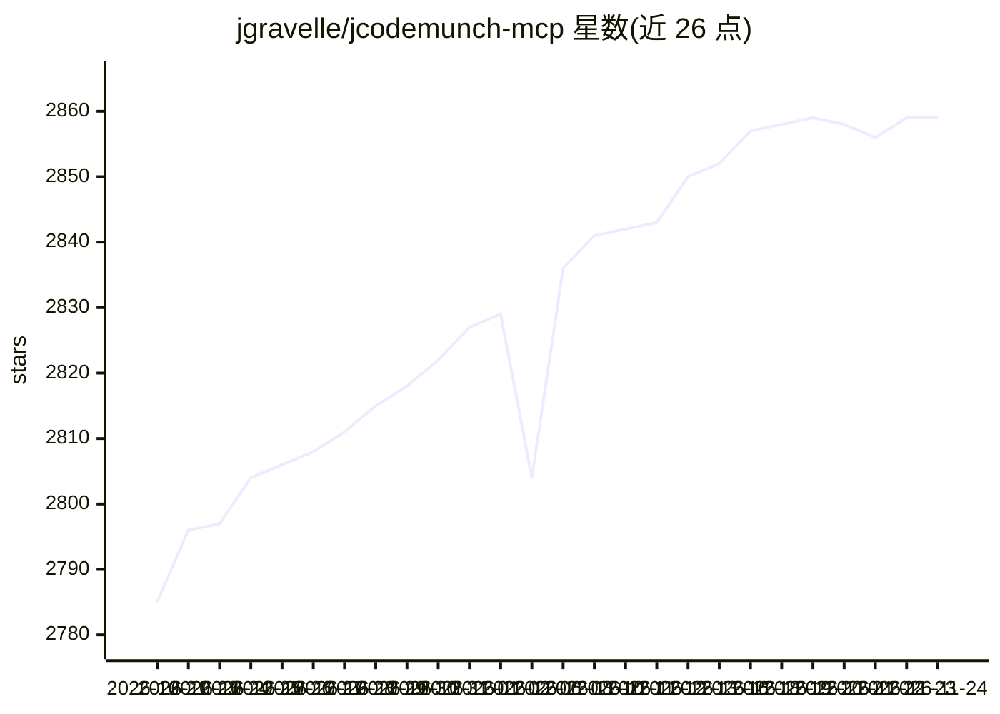

# jgravelle/jcodemunch-mcp

⭐ 2,859 · Python · NOASSERTION · 推送 2026-11-22 · [GitHub](https://github.com/jgravelle/jcodemunch-mcp) · [官网](https://jcodemunch.com/) · 个人维护

**为 AI 编码代理提供符号级代码检索的本地 MCP 服务器**

基于 tree-sitter AST 解析的 MCP 服务器，将代码库索引为符号级元数据（签名、限定名、摘要、字节偏移），代理可经 search_symbols 与 get_symbol_source 精确取回函数/类源码而非整文件，并提供 get_blast_radius、find_importers 等结构化查询。init 命令自动检测并写入多种 MCP 客户端配置、安装保持索引新鲜的钩子。README 给出以 tiktoken 计数的 token 效率基准与复现文档；默认启用六工具精简入口，完整工具集需展开。个人使用免费，商业使用需购买许可。

## 筛选速览

| 维度 | 判定 | 备注 |
|---|---|---|
| AI 角色 | `ai-ecosystem` | LLM/agent 周边工具 |
| 许可风险 | `none` | NOASSERTION |
| 部署形态 | `library` | 以包/库形式分发 |
| 模型依赖 | — | README 未给出锁定关系 |
| 硬件要求 | — | 无带数字的原话,不猜 |
| 安装摩擦 | `low` | 无编译、无系统依赖或容器化 |
| 成熟度 | — | 结构信号不足 |

## 能力要点

- tree-sitter 解析，按符号检索源码，附带字节级偏移
- get_blast_radius / find_importers / get_class_hierarchy 等结构化查询
- init 自动检测 MCP 客户端并写入配置与索引刷新钩子
- 提供预置 starter pack 与可复现的基准测试文档

## 适用场景

- 让 Claude Code/Cursor 等代理检索代码时少读整文件、省上下文窗口
- 变更影响分析：查询改动某符号会波及哪些文件与符号
- 为常用框架预建索引，跳过首次索引等待

## 场景标签

 · 领域:开发者工具/AI 编码

## 证据(README 行号)

> L3: **An MCP server that retrieves source code by symbol, not by file, using tree-sitter AST parsing.** It uses 96.3% fe
> L11: Works with **Claude Code**, **Cursor**, **VS Code**, **Codex CLI**, **Windsurf**, **Continue**, and any MCP-compati

## 星数曲线

2026-10-21 2,785 → 2026-11-24 2,859（+74）

---
*卡片 v1 · prompt 1.4 · 生成 2026-11-23 · 置信度 high · 依据 README sha `d4d80a9664aa` · [字段定义](../../DATASET.md)*
