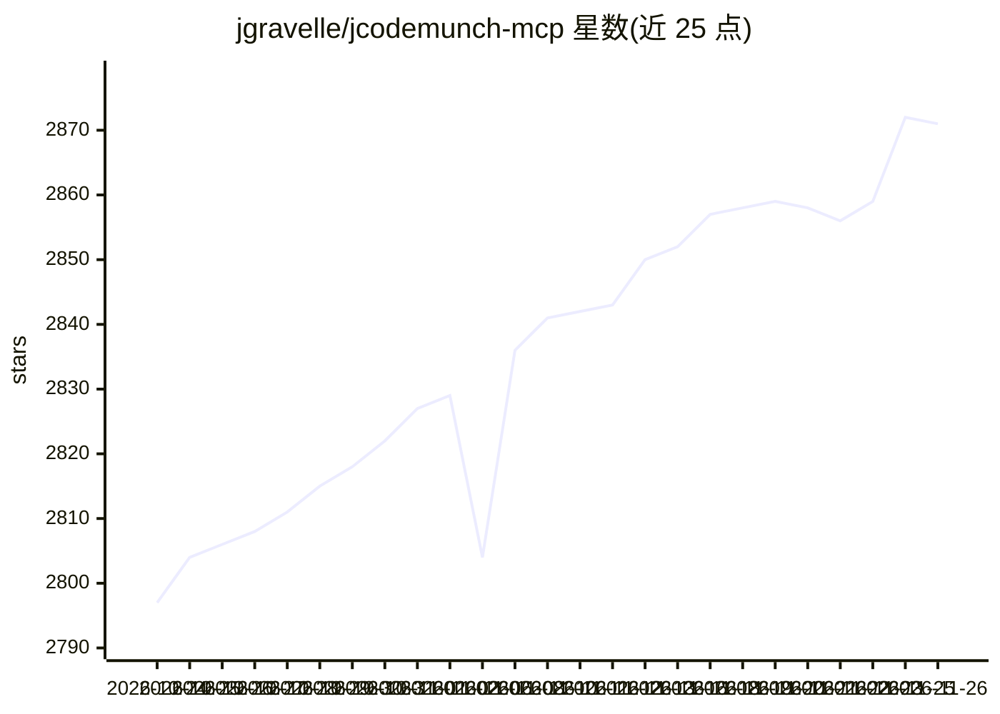

# jgravelle/jcodemunch-mcp

⭐ 2,871 · Python · NOASSERTION · 推送 2026-11-25 · [GitHub](https://github.com/jgravelle/jcodemunch-mcp) · [官网](https://jcodemunch.com/) · 个人维护

**MCP 服务器：按符号检索代码，减少 agent 上下文消耗**

一个本地运行的 MCP 服务器，用 tree-sitter AST 解析代码库并建立本地索引，让 AI agent 按函数、类、方法等符号粒度检索源码，替代整文件读取；提供 search_symbols、get_symbol_source、get_blast_radius、find_importers 等工具，附带可复现的 token 消耗基准与 A/B 测试报告。面向使用 Claude Code、Cursor 等 MCP 客户端的开发者，个人使用免费，商业使用需购买许可。

## 筛选速览

| 维度 | 判定 | 备注 |
|---|---|---|
| AI 角色 | `ai-ecosystem` | LLM/agent 周边工具 |
| 许可风险 | `none` | NOASSERTION |
| 部署形态 | `library` | 以包/库形式分发 |
| 模型依赖 | — | README 未给出锁定关系 |
| 硬件要求 | — | 无带数字的原话,不猜 |
| 安装摩擦 | `low` | 无编译、无系统依赖或容器化 |
| 成熟度 | — | 结构信号不足 |

## 能力要点

- 基于 tree-sitter AST 解析的符号级索引与按需检索
- 提供 get_blast_radius、find_importers 等跨仓库结构化查询
- init 自动检测 MCP 客户端并写入配置、安装索引刷新 hooks
- 默认六工具前置门面，完整工具集按需启用

## 适用场景

- 让 agent 精确取用所需函数而非整读文件
- 在改代码前评估影响范围与受影响符号
- 检索仓库结构、类层级与死代码

## 场景标签

 · 领域:开发者工具/AI 编程辅助

## 证据(README 行号)

> L3: **An MCP server that retrieves source code by symbol, not by file, using tree-sitter AST parsing.** It uses 96.3% fe
> L11: Works with **Claude Code**, **Cursor**, **VS Code**, **Codex CLI**, **Windsurf**, **Continue**, and any MCP-compati
> L88: uv tool install jcodemunch-mcp

## 星数曲线

2026-10-24 2,797 → 2026-11-26 2,871（+74）

---
*卡片 v1 · prompt 1.4 · 生成 2026-11-26 · 置信度 high · 依据 README sha `ada88539172f` · [字段定义](../../DATASET.md)*
