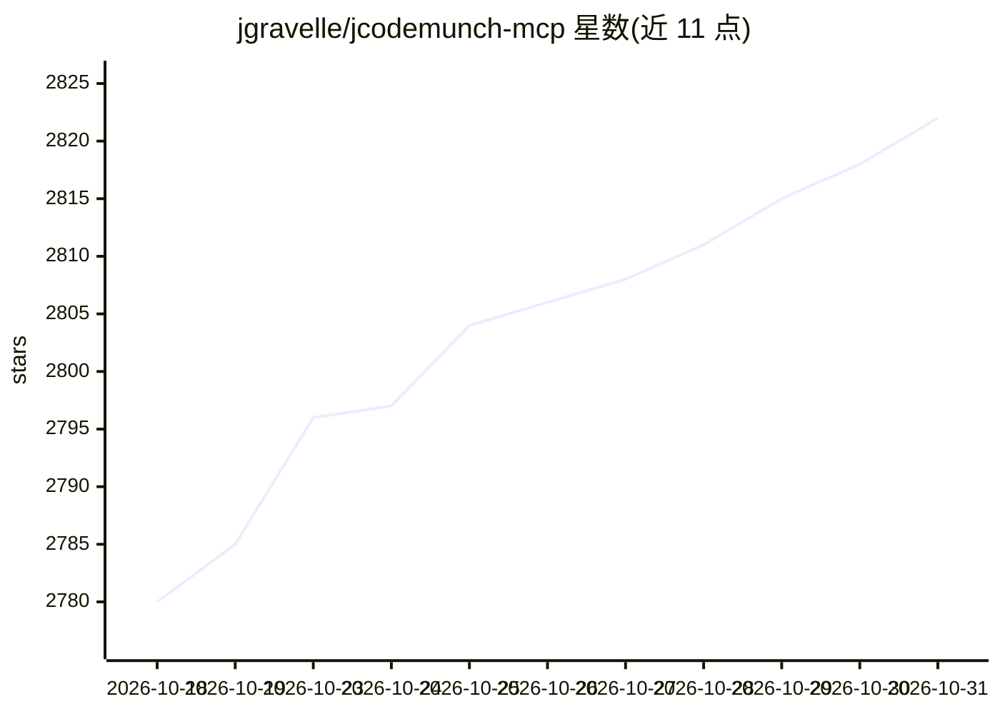

# jgravelle/jcodemunch-mcp

⭐ 2,822 · Python · NOASSERTION · 推送 2026-10-30 · [GitHub](https://github.com/jgravelle/jcodemunch-mcp) · [官网](https://jcodemunch.com/) · 个人维护

**给 AI 编程代理的 MCP 代码检索服务器：按符号精确取码省 token**

基于 tree-sitter AST 解析的 MCP 服务器，面向使用 Claude Code、Cursor、VS Code、Codex CLI 等 MCP 客户端的开发场景。它对代码库建立一次本地索引，之后代理可按符号级别检索函数、类、方法、常量的精确实现，并支持 find_importers、get_blast_radius、get_call_hierarchy 等结构化查询，README 给出基准数据（对比 grep-and-read 平均减少 96.6% token）。安装通过 uv/pipx/pip 进行，init 命令可自动配置多个 MCP 客户端。个人使用免费，商业使用需商业许可。

## 筛选速览

| 维度 | 判定 | 备注 |
|---|---|---|
| AI 角色 | `ai-ecosystem` | LLM/agent 周边工具 |
| 许可风险 | `none` | NOASSERTION |
| 部署形态 | `library` | 以包/库形式分发 |
| 模型依赖 | — | README 未给出锁定关系 |
| 硬件要求 | — | 无带数字的原话,不猜 |
| 安装摩擦 | `low` | 无编译、无系统依赖或容器化 |
| 成熟度 | — | 结构信号不足 |

## 能力要点

- tree-sitter AST 解析建本地索引，按符号精确检索代码
- 提供 find_importers/get_blast_radius/get_call_hierarchy 等结构化查询
- init 自动检测并配置 Claude Code/Cursor/Windsurf 等多个 MCP 客户端
- 90+ 工具，含编辑安全检查、PR 风险评估与置信度评分

## 适用场景

- 在大仓库或不熟悉的代码库中让代理按需取用单个函数而非整文件
- 做重构前的影响分析（blast radius、调用层级）
- 降低团队 AI 编程代理的 token 成本

## 场景标签

 · 领域:开发者工具/代码智能

## 证据(README 行号)

> L3: **The most token-efficient MCP server for precise source code retrieval via tree-sitter AST parsing.** Cut AI token 
> L9: Works with **Claude Code**, **Cursor**, **VS Code**, **Codex CLI**, **Windsurf**, **Continue**, and any MCP-compatib
> L89: `init` auto-detects your MCP clients (Claude Code, Claude Desktop, Cursor, Windsurf, Continue), writes their config

## 星数曲线

2026-10-18 2,780 → 2026-10-31 2,822（+42）

---
*卡片 v1 · prompt 1.4 · 生成 2026-10-21 · 置信度 high · 依据 README sha `23342249e7b2` · [字段定义](../../DATASET.md)*
