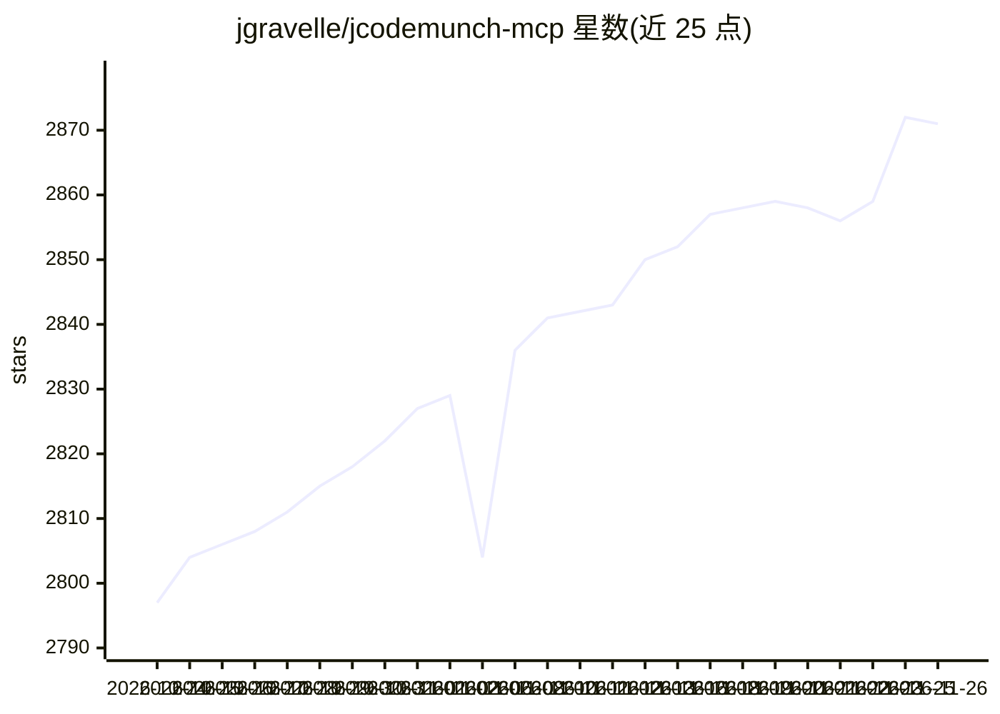

# jgravelle/jcodemunch-mcp

⭐ 2,871 · Python · NOASSERTION · 推送 2026-11-25 · [GitHub](https://github.com/jgravelle/jcodemunch-mcp) · [官网](https://jcodemunch.com/) · 个人维护

**面向 AI agent 的符号级代码检索 MCP 服务器，按需取函数而非整文件**

以 MCP 服务器形式运行于本地：用 tree-sitter 解析代码库，构建包含签名、类型、限定名、摘要与字节偏移的符号索引，agent 通过 search_symbols、get_symbol_source 等工具按符号取回代码，另有 get_blast_radius、find_importers 等结构化查询。安装时自动探测并写入 Claude Code、Cursor 等客户端配置，并提供钩子维持索引新鲜。README 称基准测试中每次查找平均减少 96.3% token；非商业免费，商业使用需购买许可。

## 筛选速览

| 维度 | 判定 | 备注 |
|---|---|---|
| AI 角色 | `ai-ecosystem` | LLM/agent 周边工具 |
| 许可风险 | `none` | NOASSERTION |
| 部署形态 | `library` | 以包/库形式分发 |
| 模型依赖 | — | README 未给出锁定关系 |
| 硬件要求 | — | 无带数字的原话,不猜 |
| 安装摩擦 | `low` | 无编译、无系统依赖或容器化 |
| 成熟度 | — | 结构信号不足 |

## 能力要点

- tree-sitter AST 解析，符号级检索（函数/类/方法/常量/大纲）
- 六工具默认入口，完整工具集可查看（surface 命令）
- init 自动探测并写入多客户端配置，含索引保鲜钩子
- 提供 starter packs 预置流行框架索引

## 适用场景

- 让 Claude Code/Cursor 等 agent 检索代码时只取所需符号以节省上下文窗口
- 查询修改某符号的影响范围与引用方
- 大型仓库中探索模块结构与导入关系

## 场景标签

`编码 Agent` · 领域:编码与开发

## 证据(README 行号)

> L3: **An MCP server that retrieves source code by symbol, not by file, using tree-sitter AST parsing.** It uses 96.3% fe
> L11: Works with **Claude Code**, **Cursor**, **VS Code**, **Codex CLI**, **Windsurf**, **Continue**, and any MCP-compati
> L32: **jCodeMunch indexes a codebase once and lets agents retrieve only the exact code they need**: functions, classes, 

## 星数曲线

2026-10-24 2,797 → 2026-11-26 2,871（+74）

---
*卡片 v1 · prompt 1.4 · 生成 2026-11-24 · 置信度 high · 依据 README sha `afbbd7f4003c` · [字段定义](../../DATASET.md)*
