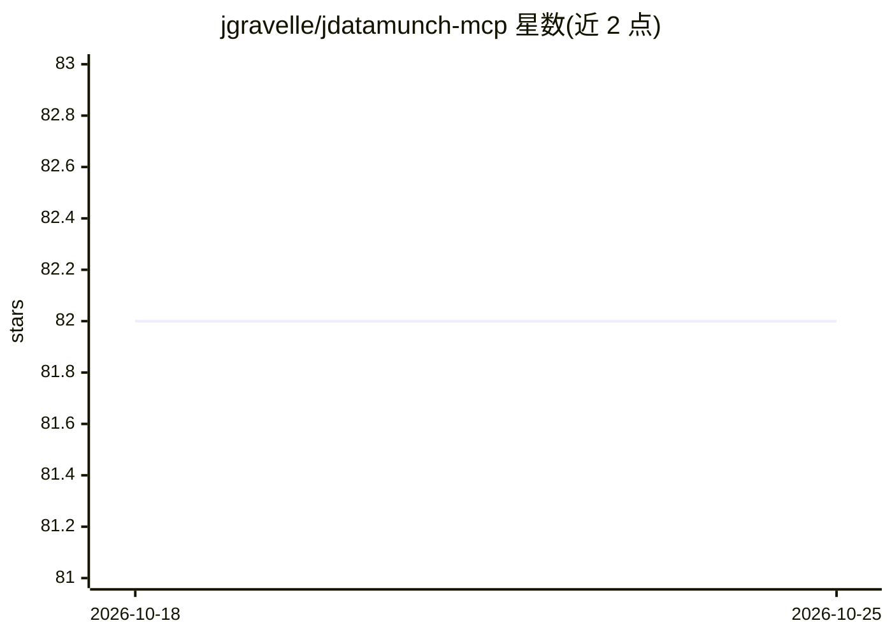

# jgravelle/jdatamunch-mcp

⭐ 82 · Python · NOASSERTION · 推送 2026-10-21 · [GitHub](https://github.com/jgravelle/jdatamunch-mcp) · 个人维护

**面向编码代理的表格数据检索 MCP 服务器，省 token 查询 CSV/Excel**

jDataMunch 是一个 stdio MCP 服务器，供 Claude Code、Cursor 等 MCP 客户端中的代理与分析师查询 CSV/Excel/Parquet/JSONL 文件。机制：先在本地对文件做列级画像（类型、基数、空值率、分布）并存储索引；过滤、聚合、join、SQL 在服务端执行，仅返回结果，原始文件不进入上下文窗口。README 给出 39 个工具，含数据质量检查、跨数据集 join、语义搜索、GitHub 仓库索引。全部本地运行，不上传数据。限制：节省随文件大小变化，小文件差异可忽略；Excel/Parquet 需可选 extras。个人使用免费，商用需付费许可（Dual-Use License）。

## 筛选速览

| 维度 | 判定 | 备注 |
|---|---|---|
| AI 角色 | `ai-ecosystem` | LLM/agent 周边工具 |
| 许可风险 | `none` | NOASSERTION |
| 部署形态 | `library` | 以包/库形式分发 |
| 模型依赖 | locked-api |  |
| 硬件要求 | — | 无带数字的原话,不猜 |
| 安装摩擦 | `low` | 无编译、无系统依赖或容器化 |
| 成熟度 | — | 结构信号不足 |

## 能力要点

- 索引一次后服务端执行过滤/聚合/join，仅返回结果（README 称 99%+ token 节省）
- 39 个工具：列画像、get_rows、aggregate、run_sql、suggest_joins、数据质量检查、语义搜索
- 支持 CSV/TSV/JSONL 内置，Excel/Parquet 经可选 extras，可从 GitHub 仓库增量索引
- 本地运行，索引与查询不上传数据；匿名节省计数器可环境变量关闭

## 适用场景

- 让编码代理探索大型 CSV/Excel 而不把整表贴进上下文
- 对陌生数据集做列画像、分布与相关性分析
- 跨多个数据集做 join 与数据质量检查
- 在删除或重命名列之前做 schema 影响预检

## 场景标签

`数据分析` · 领域:效率与自动化

## 证据(README 行号)

> L3: **jDataMunch is an MCP server for coding agents and analysts that answers questions about CSV, Excel, Parquet, and J
> L5: Index a dataset once, then retrieve column profiles, filtered rows, server-side aggregations, and cross-dataset join

## 星数曲线

2026-10-18 82 → 2026-10-25 82（+0）

---
*卡片 v1 · prompt 1.4 · 生成 2026-10-24 · 置信度 high · 依据 README sha `61d21b8df472` · [字段定义](../../DATASET.md)*
