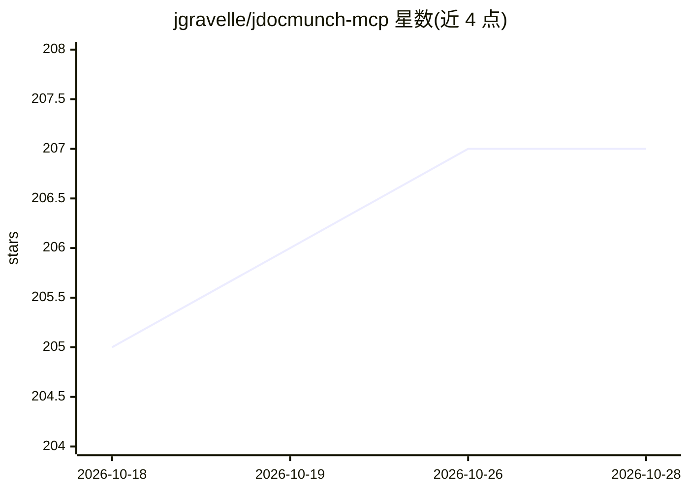

# jgravelle/jdocmunch-mcp

⭐ 207 · Python · NOASSERTION · 推送 2026-10-24 · [GitHub](https://github.com/jgravelle/jdocmunch-mcp) · [官网](https://j.gravelle.us/jDocMunch) · 个人维护

**面向编码 agent 的 MCP 文档检索服务器：按章节索引精确取用**

jDocMunch 是一个 MCP 服务器，供编码 agent 检索文档时按章节而非整文件取用内容。机制：将文档集按标题层级解析为章节树，存储各章节在原文件中的字节偏移，agent 可取单个章节、标题子树或 BM25 与语义余弦融合的排序搜索结果。章节在路径/标题文本/标题层级不变时跨重建保持稳定 ID。附 CLI，支持索引本地文件夹与 GitHub 仓库、MDX 感知分节、扫描 PDF 的可选 OCR（本地引擎，不下载模型）。限制：文件夹上限 10,000 个文件，OCR 每文档最多读 50 页，表格与手写识别受限。个人使用免费，商业使用需付费许可。

## 筛选速览

| 维度 | 判定 | 备注 |
|---|---|---|
| AI 角色 | `ai-ecosystem` | LLM/agent 周边工具 |
| 许可风险 | `none` | NOASSERTION |
| 部署形态 | `library` | 以包/库形式分发 |
| 模型依赖 | — | README 未给出锁定关系 |
| 硬件要求 | — | 无带数字的原话,不猜 |
| 安装摩擦 | `low` | 无编译、无系统依赖或容器化 |
| 成熟度 | — | 结构信号不足 |

## 能力要点

- 按标题层级建章节树，按字节偏移精确提取章节内容
- BM25 与语义余弦融合的 search_sections，支持 compact/snippet_bytes 压缩响应
- 章节 ID 在重建索引后保持稳定（路径/标题/层级不变时）
- 扫描 PDF 可选本地 OCR（Tesseract 或 Windows OCR，需双重开关确认）

## 适用场景

- 让编码 agent 查文档时只取所需章节，减少上下文窗口占用
- 索引 Kubernetes/SciPy 等大型文档集供 agent 精确检索
- 检查文档缺失、陈旧页面、孤儿章节与坏链（doc health 工具集）

## 场景标签

`语义搜索` `文档解析` · 领域:知识与检索

## 证据(README 行号)

> L3: **jDocMunch is an MCP server for coding agents that retrieves the exact documentation section a task needs, without 
> L22: **The mechanism.** jDocMunch parses a documentation set into a section tree keyed by heading hierarchy, stores each
> L186: - **Search by meaning, not just keywords.** `search_sections` fuses BM25 with semantic cosine when an embedding pr

## 星数曲线

2026-10-18 205 → 2026-10-28 207（+2）

---
*卡片 v1 · prompt 1.4 · 生成 2026-10-23 · 置信度 high · 依据 README sha `52ec316d0a08` · [字段定义](../../DATASET.md)*
