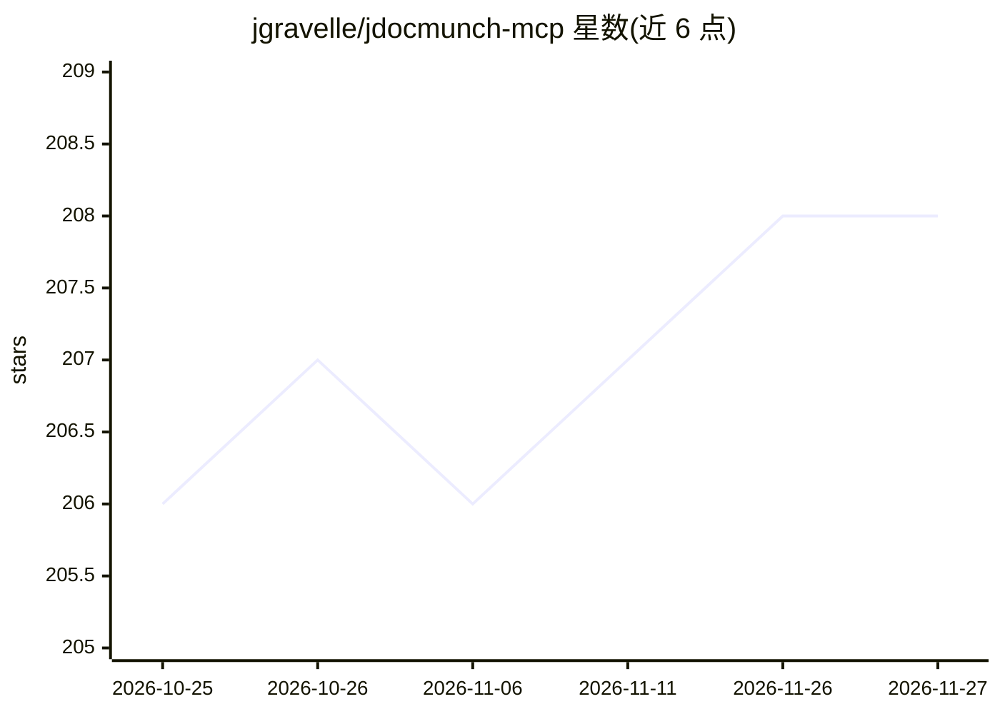

# jgravelle/jdocmunch-mcp

⭐ 208 · Python · NOASSERTION · 推送 2026-11-25 · [GitHub](https://github.com/jgravelle/jdocmunch-mcp) · [官网](https://j.gravelle.us/jDocMunch) · 个人维护

**面向编码 agent 的文档分节检索 MCP 服务器**

将文档集按标题层级解析为分节树并记录字节偏移，通过 MCP 暴露检索工具，使 agent 按节获取安装说明、配置块或标题子树，而非整文件读入上下文。支持 Markdown、RST、AsciiDoc、Jupyter、HTML、OpenAPI 等格式；检索融合 BM25 与可选嵌入语义匹配；发布流程以 nDCG 0.95 重放基线作为门槛。个人使用免费，商业使用需一次性付费许可。

## 筛选速览

| 维度 | 判定 | 备注 |
|---|---|---|
| AI 角色 | `ai-ecosystem` | LLM/agent 周边工具 |
| 许可风险 | `none` | NOASSERTION |
| 部署形态 | `library` | 以包/库形式分发 |
| 模型依赖 | — | README 未给出锁定关系 |
| 硬件要求 | — | 无带数字的原话,不猜 |
| 安装摩擦 | `low` | 无编译、无系统依赖或容器化 |
| 成熟度 | — | 结构信号不足 |

## 能力要点

- 按节检索：get_section 从原文件字节偏移精确提取内容
- search_sections 在配置嵌入提供方时融合 BM25 与语义余弦
- 分节 ID 跨重建索引保持稳定
- 本地运行，配 Claude Code 及任意 MCP 客户端

## 适用场景

- 让编码 agent 按需读取文档某一节而非整文件
- 索引本地文档目录或直接索引 GitHub 仓库文档
- 用 OCR 检索扫描版 PDF 中的文本

## 场景标签

`语义搜索` `文档解析` · 领域:知识与检索

## 证据(README 行号)

> L3: **jDocMunch is an MCP server for coding agents that retrieves the exact documentation section a task needs, without 
> L22: **The mechanism.** jDocMunch parses a documentation set into a section tree keyed by heading hierarchy, stores each

## 星数曲线

2026-10-25 206 → 2026-11-27 208（+2）

---
*卡片 v1 · prompt 1.4 · 生成 2026-11-25 · 置信度 high · 依据 README sha `7dd4159cac6f` · [字段定义](../../DATASET.md)*
