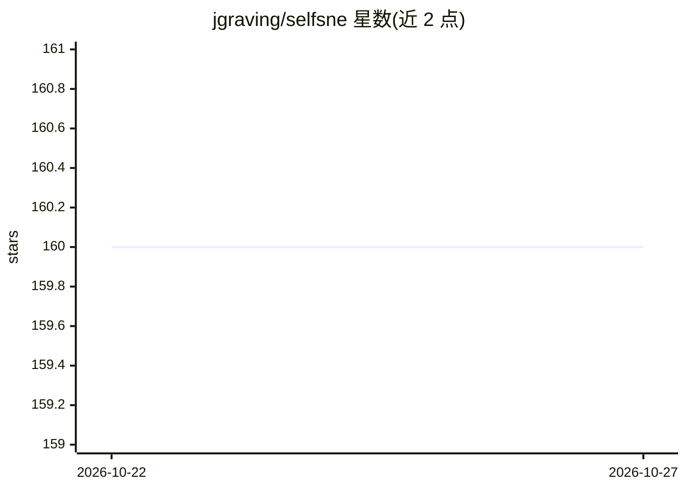

# jgraving/selfsne

⭐ 160 · Python · Apache-2.0 · 推送 2026-10-22 · [GitHub](https://github.com/jgraving/selfsne) · 个人维护

**自监督噪声嵌入库：预研重构中，暂不可用**

Self-SNE（Self-Supervised Noise Embeddings）是面向深度学习的自监督嵌入方法库，主题涉及对比学习、聚类与降维。README 声明项目正在重构与验证阶段，明确标注“尚未准备好供使用”；公开的安装说明、用法示例与发布文档将在软件就绪后补充。目前仓库仅给出名称、就绪状态声明与 Apache 2.0 许可证，无可用代码使用信息。

## 筛选速览

| 维度 | 判定 | 备注 |
|---|---|---|
| AI 角色 | `ai-native` | 本体是模型或模型工具 |
| 许可风险 | `permissive` | Apache-2.0 |
| 部署形态 | `None` |  |
| 模型依赖 | — | README 未给出锁定关系 |
| 硬件要求 | — | 无带数字的原话,不猜 |
| 安装摩擦 | `low` | 无编译、无系统依赖或容器化 |
| 成熟度 | `idea` | |

## 能力要点

- 自监督噪声嵌入（Self-Supervised Noise Embeddings）方法实现
- 主题涵盖对比学习、聚类、降维与嵌入模型
- 以 Apache 2.0 许可证发布

## 适用场景

- 待项目就绪后用于自监督表示学习实验
- 关注对比学习与降维方法的研究者跟踪该项目进展

## 场景标签

 · 领域:机器学习/表示学习

## 证据(README 行号)

> L3: This project is undergoing refactoring and validation. **It is not ready for use.**
> L6: will be added when the software is ready.

## 星数曲线

2026-10-22 160 → 2026-10-27 160（+0）

---
*卡片 v1 · prompt 1.4 · 生成 2026-10-22 · 置信度 low · 依据 README sha `ea265cd869ea` · [字段定义](../../DATASET.md)*
