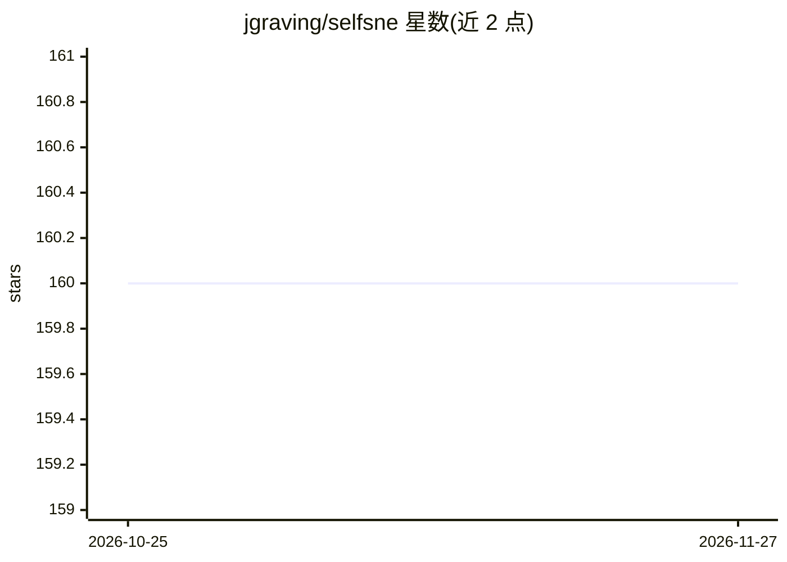

# jgraving/selfsne

⭐ 160 · Python · NOASSERTION · 推送 2026-11-24 · [GitHub](https://github.com/jgraving/selfsne) · 个人维护

**自监督对比估计学习低维嵌入的 PyTorch Lightning 库**

Self-SNE（Self-Supervised Noise Embeddings）以 PyTorch Lightning 库形式提供，通过对比散度估计学习低维嵌入表示。核心包为 CPU 运行设计，提供 data、plot、rich 等可选扩展组件；GPU 安装需参照文档中的 CUDA 说明另行操作。采用 Apache-2.0 许可，面向需要降维、聚类与嵌入学习的机器学习使用者。

## 筛选速览

| 维度 | 判定 | 备注 |
|---|---|---|
| AI 角色 | `ai-native` | 本体是模型或模型工具 |
| 许可风险 | `permissive` | NOASSERTION |
| 部署形态 | `library` | 以包/库形式分发 |
| 模型依赖 | — | README 未给出锁定关系 |
| 硬件要求 | — | 无带数字的原话,不猜 |
| 安装摩擦 | `medium` | 含编译或系统依赖之一 |
| 成熟度 | — | 结构信号不足 |

## 能力要点

- 基于对比散度估计学习低维嵌入
- 以 PyTorch Lightning 库形式提供
- CPU 核心包与 data/plot/rich 可选扩展
- Apache-2.0 许可

## 适用场景

- 对高维数据做自监督降维与嵌入学习
- 聚类与表示学习的实验与建模
- 需要 CPU 环境即可运行的嵌入计算

## 场景标签

 · 领域:机器学习/表示学习

## 证据(README 行号)

> L3: **Self-Supervised Noise Embeddings** — A PyTorch Lightning library for learning
> L4: low-dimensional embeddings via contrastive divergence estimation.

## 星数曲线

2026-10-25 160 → 2026-11-27 160（+0）

---
*卡片 v1 · prompt 1.4 · 生成 2026-11-27 · 置信度 mid · 依据 README sha `1b1363c65bc7` · [字段定义](../../DATASET.md)*
