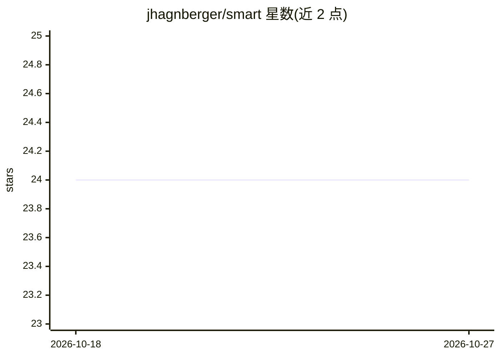

# jhagnberger/smart

⭐ 24 · Python · NOASSERTION · 推送 2026-05-18 · [GitHub](https://github.com/jhagnberger/smart) · 组织维护

**ICML 2026 论文 SMART 官方实现：从原始几何做空气动力学仿真的 Transformer 代理模型**

论文《SMART: Scalable Mesh-free Aerodynamic Simulations from Raw Geometries using a Transformer-based Surrogate Model》的官方 PyTorch 实现。模型由几何编码器、物理解码器与跨层几何-物理更新三部分组成，用于在复杂几何上求解 3D 定常 PDE，支持大规模推理（数千万查询点时分块处理避免显存溢出）。仓库提供数据集下载与准备脚本（ShapeNetCar/AhmedML 公开，SHIFT-SUV/Wing 需向 Luminary Cloud 申请）、PyTorch Dataset 类、训练与评估脚本（本地或 SLURM）。依赖 PyTorch 2.6.0，许可为 PolyForm Noncommercial 1.0.0，限非商用。

## 筛选速览

| 维度 | 判定 | 备注 |
|---|---|---|
| AI 角色 | `ai-native` | 本体是模型或模型工具 |
| 许可风险 | `none` | NOASSERTION |
| 部署形态 | `None` |  |
| 模型依赖 | — | README 未给出锁定关系 |
| 硬件要求 | — | 无带数字的原话,不猜 |
| 安装摩擦 | `low` | 无编译、无系统依赖或容器化 |
| 成熟度 | — | 结构信号不足 |

## 能力要点

- 几何编码器 + 物理解码器 + 跨层几何-物理更新的 Transformer 代理架构
- 无网格（mesh-free）方式从原始几何直接预测气动仿真物理量
- 提供分块推理方法处理 33M 体点 / 8M 面点级别大规模查询
- 四个数据集的下载、准备与训练/评估脚本，支持 SLURM 集群

## 适用场景

- 复现论文中的气动代理模型实验结果
- 在新几何数据上训练神经 PDE 代理模型
- 科研对比研究 mesh-free 神经 PDE 求解方法

## 场景标签

`科研工具` · 领域:学习与行业

## 证据(README 行号)

> L3:  SMART: Scalable Mesh-free Aerodynamic Simulations from Raw Geometries using a Transformer-based Surrogate Model
> L10: This repository contains the official PyTorch implementation of the SMART model from the paper, "**SMART: Scalable 

## 星数曲线

2026-10-18 24 → 2026-10-27 24（+0）

---
*卡片 v1 · prompt 1.4 · 生成 2026-10-27 · 置信度 high · 依据 README sha `d6e895d32374` · [字段定义](../../DATASET.md)*
