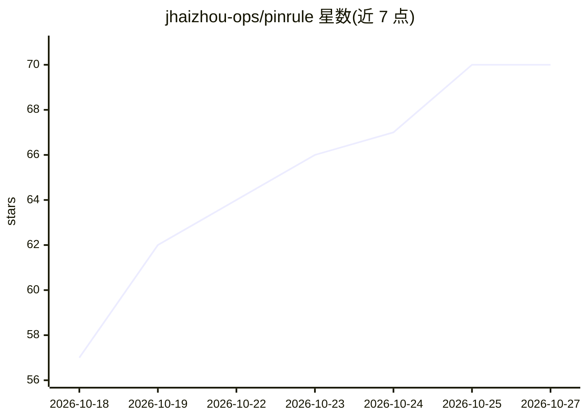

# jhaizhou-ops/pinrule

⭐ 70 · Python · MIT · 推送 2026-05-19 · [GitHub](https://github.com/jhaizhou-ops/pinrule) · [官网](https://pypi.org/project/pinrule/) · 个人维护 · 中文 README

**给 AI 编程助手的长期行为规则固定框架：防止长任务中规则漂移**

面向使用 Claude Code / Codex / Cursor / Hermes 的开发者的规则固定工具：用户维护 5-10 条核心行为方向（rules.json），引擎通过客户端 hook 在会话开始注入、每轮压缩锚点、长上下文衰减时全量重注入，并用 regex + counting 实时拦截已知漂移行为（如 sleep、先 Edit 后 Read）。运行时零 LLM、零网络、零第三方依赖，hook 延迟约 50-70ms，token 开销约 2%。规则上限 12 条，超出拒绝加载；场景规则包的生成由用户 Agent 完成，pinrule 仅本地校验与执行。通过 pip 安装并初始化 hook。

## 筛选速览

| 维度 | 判定 | 备注 |
|---|---|---|
| AI 角色 | `ai-ecosystem` | LLM/agent 周边工具 |
| 许可风险 | `permissive` | MIT |
| 部署形态 | `library` | 以包/库形式分发 |
| 模型依赖 | — | README 未给出锁定关系 |
| 硬件要求 | — | 无带数字的原话,不猜 |
| 安装摩擦 | `low` | 无编译、无系统依赖或容器化 |
| 成熟度 | — | 结构信号不足 |

## 能力要点

- hook 机制注入规则：会话开始、每轮锚点、长上下文衰减时全量重注入
- 运行时 regex + counting，零 LLM、零网络、零第三方依赖（仅 Python 标准库）
- 支持 Claude / Codex / Cursor / Hermes 四类客户端，自动检测并安装 hook
- /pinrule 命令三路分发：数据面板、单规则增删、场景规则包生成（由 Agent 完成）

## 适用场景

- 长任务中让编程助手持续遵守我的个人行为偏好，不用每 30 轮重复提醒
- 实时拦截已知的 AI 漂移行为（如硬编码、跳过测试）
- 把写作/研究/UX 等非开发场景的行为规则一键切换到对应规则包

## 场景标签

`提示工程` · 领域:Agent 开发

## 证据(README 行号)

> L51: - **Injects** your 5-10 directions at session start, compact anchor each turn, full reinject on long-context decay.
> L66: `rules.json` is the only thing you maintain. The engine reads it, injects at the right hook points, watches Agent t

## 星数曲线

2026-10-18 57 → 2026-10-27 70（+13）

---
*卡片 v1 · prompt 1.4 · 生成 2026-10-24 · 置信度 high · 依据 README sha `cbc8552b006b` · [字段定义](../../DATASET.md)*
