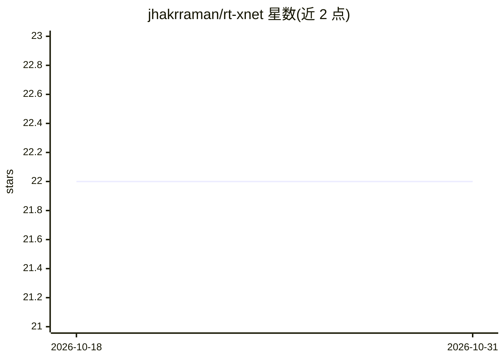

# jhakrraman/rt-xnet

⭐ 22 · Python · MIT · 推送 2025-11-06 · [GitHub](https://github.com/jhakrraman/rt-xnet) · [官网](https://arxiv.org/abs/2505.24705) · 组织维护

**RGB-热红外跨注意力网络，用于低光照图像增强**

ICIP 2025 论文 RT-X Net 的官方实现：输入共位的可见光-热红外图像对，通过跨注意力 Transformer 网络输出低光照增强图像，基于 Retinexformer 代码构建。提供 Conda 环境配置、BasicSR 依赖安装、LLVIP 与自发布 V-TIEE 数据集的准备流程，以及训练与测试命令；预训练权重从 Google Drive 与 Hugging Face 获取。面向计算机视觉研究者复现实验或使用 V-TIEE 数据集做低光照增强与 HDR 研究。

## 筛选速览

| 维度 | 判定 | 备注 |
|---|---|---|
| AI 角色 | `ai-native` | 本体是模型或模型工具 |
| 许可风险 | `permissive` | MIT |
| 部署形态 | `library` | 以包/库形式分发 |
| 模型依赖 | — | README 未给出锁定关系 |
| 硬件要求 | — | 无带数字的原话,不猜 |
| 安装摩擦 | `low` | 无编译、无系统依赖或容器化 |
| 成熟度 | — | 结构信号不足 |

## 能力要点

- RGB-热红外跨注意力网络的低光照图像增强实现
- 发布 V-TIEE 真实世界可见光-热红外配对数据集
- 提供 LLVIP/V-TIEE 训练与测试命令及预训练权重
- 基于 BasicSR 框架与 Retinexformer 代码

## 适用场景

- 复现 ICIP 2025 低光照增强实验
- 使用 V-TIEE 数据集做低光照增强或 HDR 研究
- 在 LLVIP 数据集上训练/评测 RT-X Net

## 场景标签

`图像视频处理` · 领域:感知与多模态

## 证据(README 行号)

> L1: # RT-X Net: RGB-Thermal cross attention network for Low-Light Image Enhancement
> L99: Our work is based on Retinexformer. We thank the authors for releasing their code.

## 星数曲线

2026-10-18 22 → 2026-10-31 22（+0）

---
*卡片 v1 · prompt 1.4 · 生成 2026-10-27 · 置信度 high · 依据 README sha `4eaf76b32476` · [字段定义](../../DATASET.md)*
